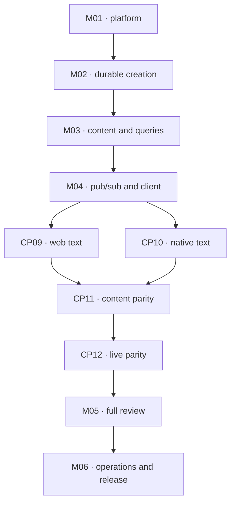

# 01 — MVP roadmap

## Outcome and boundaries

Build the local Windows messaging MVP defined in [the source specification](../specs/local-messaging-design-specification-v1.md): one independent per-user host, a genuine loopback HTTP/3 messaging listener, a separate frontend API, EF Core/SQLite, and two equal-capability clients (WinUI 3 and plain HTML/JavaScript/CSS).

The plan preserves no-auth logical users, public targeting, immutable create-only content, text/PNG/JPEG messages, three total thread levels, atomic compound creation, durable replay and queryable subscriptions. It does not add authentication, private messaging, edit/delete, offline send queues, a Windows Service installer, remote hosting, or a frontend framework.

The target baseline is the source's Windows 11 x64 release environment and .NET/EF Core 10 family. Exact supported patch versions, Windows build, and stable Windows App SDK inputs are verified and pinned by T001; this plan does not invent current package versions.

## Milestones and exit outcomes

| Milestone | Stage | Tasks | Checkpoints | Required exit outcome |
| --- | --- | --- | --- | --- |
| M01 | [Foundation and transport qualification](../milestones/M01-foundation.md) | T001–T006 | CP01, CP02 | A real Windows baseline can be built and operated; transport/platform risks are exercised before domain features. |
| M02 | [Durable creation and ownership](../milestones/M02-durable-creation.md) | T007–T012 | CP03, CP04 | All creation combinations preserve owners and committed identity through real SQLite and actual HTTP/3 requests. |
| M03 | [Content and query completeness](../milestones/M03-content-and-queries.md) | T013–T018 | CP05, CP06 | The complete content model is usable through both API surfaces with bounded query and image behavior. |
| M04 | [Durable pub/sub and reusable client](../milestones/M04-pubsub-and-client.md) | T019–T024 | CP07, CP08 | Persisted content and durable real-time delivery work end to end across snapshot, restart, sparse filters, and slow consumers. |
| M05 | [Web and WinUI feature parity](../milestones/M05-frontends.md) | T025–T034 | CP09, CP10, CP11, CP12 | Both actual frontends run together against the same host and demonstrate equivalent persisted results and errors. |
| M06 | [Operations and release qualification](../milestones/M06-release.md) | T035–T040 | CP13, CP14 | The exact release candidate satisfies all A01–A50 and every milestone finding/warning is resolved and reverified. |

Every row also requires MG01–MG06 from [gates and full reviews](02-gates-and-reviews.md). A stage outcome alone is insufficient for exit.

## Dependency flow

M01–M04 each include their full milestone review before the next milestone begins. CP09–CP12 are inside M05; M06 also has its own final full review after CP14.

## Checkpoint map

| ID | Milestone | Required tasks | Prior checkpoints | Integrated outcome |
| --- | --- | --- | --- | --- |
| CP01 | M01 | T001, T002, T003 | None; required tasks accepted | Executable baseline and real transport |
| CP02 | M01 | T004, T005, T006 | CP01 | Local boundary and durable platform |
| CP03 | M02 | T007, T008, T009 | Previous milestone exit | Idempotent profiles and independent ownership |
| CP04 | M02 | T010, T011, T012 | CP03 | Persisted publish and uncertain-write recovery |
| CP05 | M03 | T013, T014, T015 | Previous milestone exit | Stable browsing, targets, and threads |
| CP06 | M03 | T016, T017, T018 | CP05 | Complete content API |
| CP07 | M04 | T019, T020, T021 | Previous milestone exit | Queryable durable subscriptions |
| CP08 | M04 | T022, T023, T024 | CP07 | Recoverable live delivery and native client |
| CP09 | M05 | T025, T026 | Previous milestone exit | Browser text conversation |
| CP10 | M05 | T030, T031 | Previous milestone exit | Native text conversation |
| CP11 | M05 | T027, T028, T032, T033 | CP09, CP10 | Content parity across both frontends |
| CP12 | M05 | T029, T034 | CP11 | Live frontend parity and identity recovery |
| CP13 | M06 | T035, T036, T037 | Previous milestone exit | Independent operation and safe maintenance |
| CP14 | M06 | T038, T039, T040 | CP13 | Qualified distributable MVP candidate |

Each checkpoint's complete preconditions, steps, expected results, command, and unlocked work are in its milestone file. A checkpoint needs both accepted constituent tasks and a fresh integrated scenario; collecting task-pass records is not an integration test.

## Entry and progression rules

1. T001 is the first implementation task. All others require their explicit accepted task dependencies.
2. Every task in M02–M06 also requires the previous milestone's accepted full-review gate.
3. Tasks that start the second checkpoint group require the first checkpoint: CP01 before T004–T006, CP03 before T010–T012, CP05 before T016–T018, CP07 before T022–T024, CP13 before T038–T040.
4. Web content tasks T027/T028 require CP09; native content tasks T032/T033 require CP10.
5. T029 can start after its own web content tasks pass, and T034 after its own native content tasks pass. They need not wait idly for the other lane, but CP12 cannot pass until CP11 passes.
6. A gate failure stops progression through that dependency. Other genuinely independent ready work in the same milestone may continue.
7. Missing Windows/QUIC/WinUI execution means blocked. It is never replaced by a mocked or unsupported-platform pass.

The machine-readable plan records task dependencies, checkpoint entry gates, previous-milestone gates, and checkpoint prerequisites separately. All four are operative.

## Parallel work with controlled integration

| Stage | Safe opportunity | Integration constraint |
| --- | --- | --- |
| M01 | T002 contract work and T003 transport after T001; T004/T005/T006 after CP01 | Merge shared host/configuration changes in sequence and rerun CP02 together |
| M02 | Supporting test fixtures can be prepared in parallel | Durable command/ownership features follow the stated chain; one command pipeline |
| M03 | T016 images and T017 history projections after CP05 | Shared message DTO/handler changes need coordinated integration before T018 |
| M04 | Parser fixtures and race harness work can be prepared while replay is implemented | No live-completion claim before finite replay and coupled transactions pass |
| M05 | Web T025–T029 and WinUI T030–T034; text-to-thread/image work within each lane | CP11 and CP12 exercise both actual clients against one candidate |
| M06 | T036 maintenance and T037 diagnostics after T035; T038 publication and T039 qualification tooling after CP13 | T040 and CP14 must run against the final actual package |

The roadmap is dependency ordered, not a fixed calendar commitment. Use measured throughput after M01 to estimate dates. If a task is too large in practice, split it into smaller coherent runnable slices with preserved criteria, dependency links, and checkpoint coverage; do not split into accepted-but-unrunnable layers.

## Why this order

Receipts, idempotency, and EventLog begin with the first write (T007). This gives every later create flow the same retry and persistence contract. Content/query semantics stabilize before frontend work. Finite replay precedes SSE, so the live transport reuses proven durable retrieval. Image platform feasibility is tested early, while the full atomic image-message slice remains one later task. Operational shutdown and restore are qualified before distribution, and the final package is exercised on a clean machine.

See [verification and traceability](03-verification-and-traceability.md) for the important distinction between early supporting probes and actual source-scenario closure.
