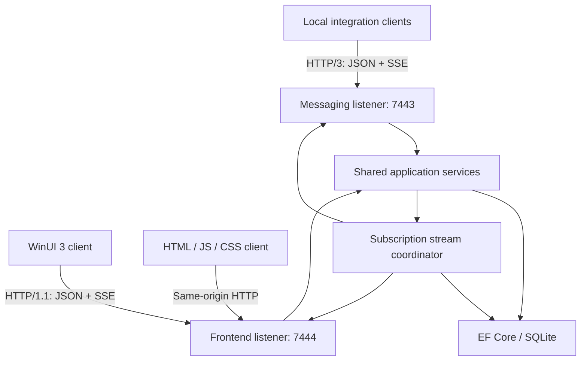
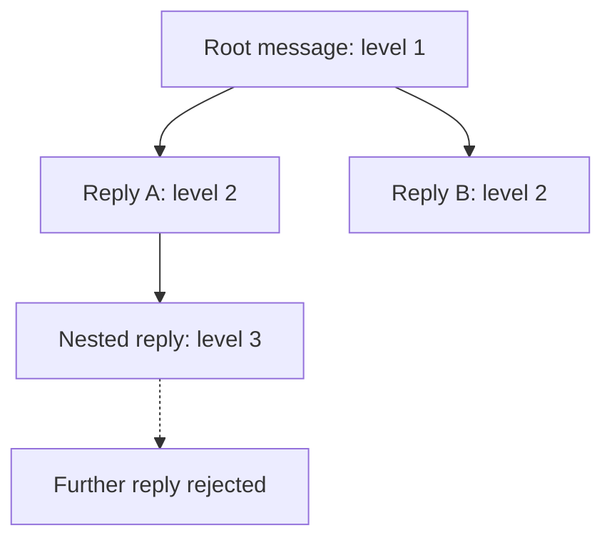
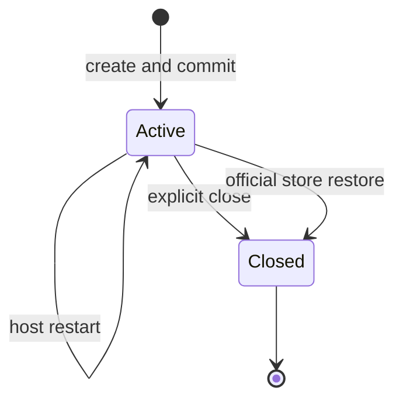
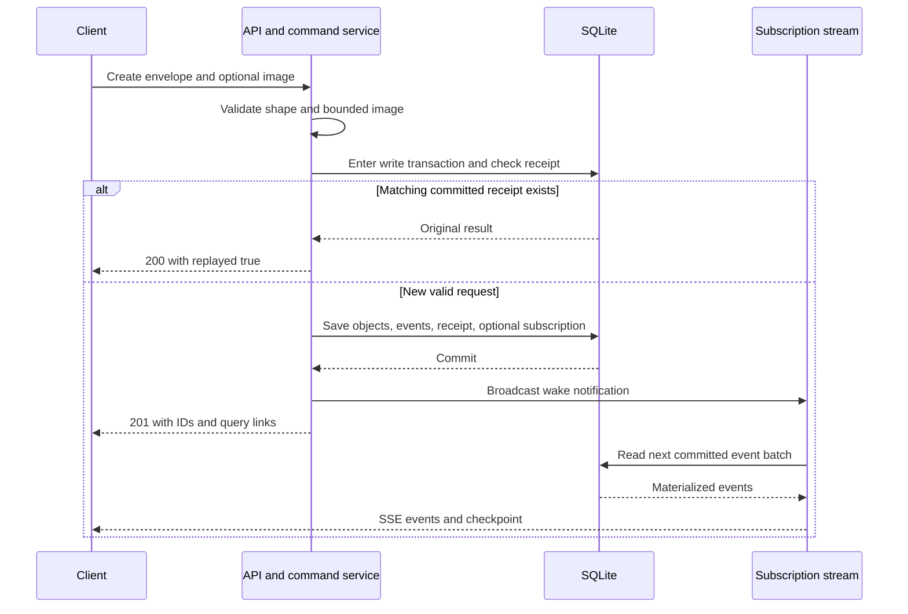
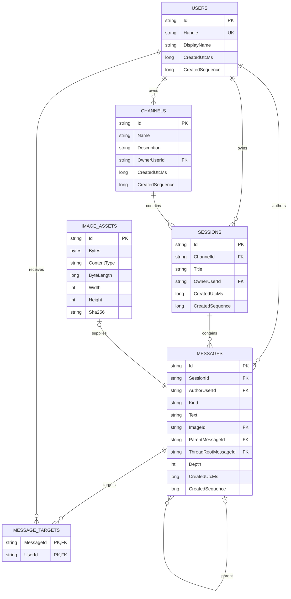

# Local .NET Messaging — Design Specification

**Version:** 1.0  
**Date:** 20 November 2026 (Asia/Singapore)  
**Status:** Proposed implementation baseline; design and research only  
**Audience:** Product owner, software architect, and implementing coding agents  
**Working application name:** Local Messaging

## Contents

- [Purpose and requirements](#1-purpose-and-scope)
- [Research and technology decisions](#3-research-findings-and-technology-decisions)
- [Architecture and listeners](#4-architecture)
- [Domain rules and create contracts](#6-domain-vocabulary-and-public-objects)
- [Queryable responses and subscriptions](#9-queryable-request-and-subscription-responses)
- [Event replay and transaction workflows](#11-event-contracts-ordering-and-replay)
- [API catalogue and data model](#13-endpoint-catalogue-and-query-contracts)
- [Frontend and image design](#16-frontend-design-and-parity)
- [Background operation and local trust](#18-background-operation-packaging-and-maintenance)
- [Errors, acceptance criteria, and implementation sequence](#20-error-contract-and-acceptance-criteria)
- [Decisions and primary references](#22-decisions-to-carry-into-implementation)

## 1. Purpose and scope

Build a small local messaging application with an independent background .NET host, an HTTP/3-over-QUIC interface for local messaging clients, and a separate frontend API. Provide a native WinUI 3 client and a plain HTML, JavaScript, and CSS client. Persist the application in a local SQLite database through Entity Framework Core.

The four user-facing dataobjects are **User, Channel, Session, and Message**. Messages contain plain text or one image with an optional caption. Every user can create channels, sessions, and messages and can view all conversations. User creation and selection require no authentication.

This specification defines what the first implementation should do. Its proposed application behavior is a design decision unless explicitly attributed to a source. Platform claims are grounded in the primary references in Section 23. No application has been built or runtime-tested as part of this document.

### 1.1 Explicit interpretations

| Phrase in the request | Interpretation used in this specification |
|---|---|
| Runs locally and in the background | One independent Windows process, normally started for the current Windows account. Closing either frontend does not stop it. |
| HTTP3/QUIC pub/sub | JSON commands and queries plus Server-Sent Events (SSE), transported through a real HTTP/3-only Kestrel listener. HTTP/3 already uses QUIC; a second custom raw-QUIC protocol is unnecessary. |
| Separate API endpoint | A different listener and port for the two frontends, with actual port-based route isolation. |
| Start a channel | Commit a channel and its first session and make both immediately discoverable and subscribable. It does not mean launching a worker or thread per channel. |
| Session | A persistent conversation inside a channel. It is independent of an HTTP connection, subscription, or UI login. |
| Queryable sub response | A durable subscription descriptor with an ID, metadata query, finite event query, and live stream. Accepted create requests also have queryable receipts. |
| New channel in a request | Explicit `create` selection; never an unknown existing ID that implicitly creates data. A new channel always creates its initial session atomically. |
| `@user` targeting | Additional routing to the target user's mentions feed and a visible target indicator. The message remains visible in the conversation. |
| Threading, maximum three deep | Three total levels: root = 1, reply = 2, nested reply = 3. Creating level 4 fails. |
| All users have the same abilities | Ownership records attribution. Owners have no additional permissions in this version. |
| No edit or delete | Users, channels, sessions, and messages have no edit/delete operations. Closing a subscription and maintaining the database are operational actions. |

The intended deployment is one local application instance used by one Windows account, with multiple logical users and local integration callers. A logical user can represent a human or a local agent. Logical profiles are self-asserted identities.

### 1.2 Included essentials

The first release includes input validation, atomic creates, request idempotency, durable event replay, reconnect handling, bounded streams, pagination, image limits, useful error codes, startup diagnostics, and a documented backup/restore procedure.

It does not include authentication, roles, invitations, private conversations, remote access, federation, presence, typing indicators, reactions, read receipts, message editing, deletion, retention policies, full-text search, rich text, arbitrary file attachments, audio/video, offline synchronization, or an external broker.

## 2. Requirements and traceability

| ID | Requirement | Design coverage | Acceptance coverage |
|---|---|---|---|
| R01 | Run independently in the background | Sections 4, 18 | A01, A02 |
| R02 | Local HTTP/3/QUIC pub/sub | Sections 3–5, 10–12 | A03, A04, A05 |
| R03 | Separate frontend API | Sections 4–5, 13 | A06, A07 |
| R04 | User/channel/session/message dataobjects | Sections 6–9, 14 | A08–A14 |
| R05 | Request contract carries dataobject | Sections 8 | A08–A16 |
| R06 | Queryable subscription response | Sections 9–12 | A17–A22 |
| R07 | New channel creates first session; caller owns both | Sections 7–9 | A09, A10 |
| R08 | Another caller creates/owns a session in an existing channel | Sections 7 | A11 |
| R09 | Publish all channels and sessions for discovery/subscription | Sections 10, 13, 15 | A18, A23 |
| R10 | Target users with `@user` | Sections 7, 8, 10, 16 | A24–A26 |
| R11 | Threads no deeper than three levels | Sections 7, 14, 16 | A27–A29 |
| R12 | Text and image messages | Sections 8, 14, 17 | A30–A33 |
| R13 | EF Core + local SQLite | Sections 3, 14, 18 | A34–A38 |
| R14 | WinUI 3 frontend | Sections 16 | A39–A42 |
| R15 | HTML/JS/CSS frontend without a framework | Sections 16 | A39–A42 |
| R16 | Basic user creation without authentication | Sections 6–8, 16, 19 | A08, A43 |
| R17 | Every user can create channel/session/message | Sections 7, 13, 16 | A11, A43 |
| R18 | No content edit/delete in initial scope | Sections 1, 13, 21 | A44 |
| R19 | Minimal reliability and operational behavior | Sections 11–12, 17–20 | A15–A16, A20–A22, A34–A38 |

## 3. Research findings and technology decisions

### 3.1 Recommended baseline

| Component | Decision | Reason |
|---|---|---|
| Runtime | .NET 10 LTS, latest supported servicing patch at build time | Provides all required capabilities and a supported baseline. |
| Backend | ASP.NET Core 10 with Kestrel and Generic Host | Hosting, lifecycle, DI, configuration, HTTP endpoints, and background tasks in one process. |
| Persistence | EF Core 10 + Microsoft.EntityFrameworkCore.Sqlite | Direct entity mapping to a single local database. Keep EF packages on compatible servicing versions. |
| Native UI | WinUI 3 using a supported stable Windows App SDK release | Native Windows frontend; pin the exact SDK package during implementation qualification. |
| Web UI | Static HTML + CSS + ES modules | No frontend framework, bundler, Node runtime, or CDN required at runtime. |
| Wire format | Versioned JSON; multipart for image commands; SSE for live events | Easy to inspect, implement, and use from .NET and browser clients. |
| Image validation | Win32 Windows Imaging Component (WIC), restricted to built-in PNG/JPEG decoders | Desktop/server image APIs; no broad media-processing subsystem. |
| Initial OS | Supported Windows 11 x64 | Common supported target for the host's QUIC stack and WinUI client. |
| Additional qualification | Windows Server 2025 host + browser client | Backend qualification target; native WinUI on Server 2025 is not a promised v1 target. |
| Deployment | Self-contained folder distribution, independent host and desktop executables | Avoid dependence on an installed .NET runtime and avoid MSIX/service packaging complexity initially. |

Microsoft's support policy lists .NET 10 as an LTS release supported through **14 November 2028**. .NET 11 is also available as of the research date, but this design has no requirement that needs the new major version. Recheck servicing versions when implementation starts. [S01]

The .NET Windows support page explicitly includes Windows Server 2025. The Windows App SDK support matrix retrieved for this research does not establish an equivalent explicit WinUI Server 2025 guarantee. Consequently, qualify the backend separately from the native frontend. [S02, S03]

Some Microsoft Learn pages currently show inconsistent version banners. Use Microsoft's explicit support policy for lifecycle status and the selected version's API references for implementation. The exact Windows App SDK patch is a build qualification decision, not an invented number in this design.

### 3.2 Transport research

HTTP/3 uses QUIC and TLS 1.3. The .NET implementation uses MsQuic; on Windows its native dependency is supplied with .NET. Microsoft documents Windows 11/Windows Server 2022 or later as the relevant Windows QUIC baseline. Raw `System.Net.Quic` APIs are stable from .NET 9, but using them directly would require a custom application protocol. [S04, S05]

Microsoft's Kestrel documentation explicitly warns that browsers do not support self-signed certificates for localhost HTTP/3, including the normal ASP.NET Core development certificate. The browser is therefore not required to use the messaging listener. [S05]

ASP.NET Core 10 provides SSE results, and .NET provides an SSE parser. This makes JSON POST + SSE a suitable fit for create-only commands and server-originated updates. The application's durable subscription/replay behavior is still its own responsibility. [S06, S07]

| Candidate | Decision for v1 |
|---|---|
| JSON POST + SSE over HTTP/3 | Selected for the messaging listener. |
| JSON POST + SSE over loopback HTTP/1.1 | Selected for both frontends. |
| SignalR | Not needed for the current interaction model; do not infer HTTP/3 compliance from a working SignalR connection. |
| WebSockets | Additional full-duplex protocol is unnecessary for create requests plus notifications. |
| Raw QUIC | Would add custom framing, protocol negotiation, and browser bridging without meeting an additional requirement. |
| gRPC | Not needed; a second browser adaptation layer would complicate the plain web client. |
| External broker | Not needed for a single-process local application with SQLite-backed replay. |

Microsoft generally recommends HTTP/1.1/2 fallback alongside HTTP/3. Here the separately exposed frontend API supplies a compatible interface, while the dedicated messaging listener is deliberately strict so the explicit QUIC requirement remains testable. The product must not claim HTTP/3 availability when only the frontend listener works. [S05, S08]

### 3.3 Persistence research implications

EF Core contexts are short-lived units of work and are not thread-safe. Microsoft.Data.Sqlite's asynchronous ADO.NET methods still perform synchronous I/O. SQLite WAL permits concurrent readers and a writer but does not create multiple concurrent writers. [S09, S10, S11]

Therefore:

- The backend alone owns the database.
- Each command and finite query uses a short-lived context.
- One process-wide write gate serializes short write transactions.
- Live streams never retain a database context or transaction while waiting for clients.
- Domain mutations, receipts, images, and their event entries commit together.
- SQLite is stored on a local disk, outside the application installation directory.

## 4. Architecture

### 4.1 Process and component topology



The host contains both listeners, command/query handlers, persistence, and the stream coordinator. The diagram shows logical components inside one backend process. WinUI and the browser are separate processes.

Both listeners invoke the same application services directly. The frontend API does not relay commands through the HTTP/3 endpoint. Neither frontend opens SQLite.

### 4.2 Logical modules

| Module | Responsibility |
|---|---|
| Host/lifecycle | Configuration, single-instance lock, startup checks, endpoints, diagnostics, orderly shutdown. |
| Contract layer | Input/output DTOs, discriminators, contract version, limits, Problem Details shape. |
| Command service | User/channel/session/message creates, ownership assignment, relational validation, idempotency. |
| Query service | Catalog, histories, threads, targets, receipts, subscription definitions. |
| Persistence | EF mappings, migrations, short transactions, image BLOBs, durable event log. |
| Subscription service | Saved filters, finite replay, SSE streaming, cursor validation, closure. |
| Image validator | Bounded PNG/JPEG decoding and metadata verification before a write transaction. |
| Frontend clients | User selection, navigation, composition, rendering, connection state, reconnect and deduplication. |

These are modules, not separate deployable services. Use a small number of projects; do not introduce a mediator framework, repository abstraction over every EF entity, event-sourcing framework, or a generic workflow engine for this scope.

### 4.3 Suggested solution layout

| Project/path | Content |
|---|---|
| `src/LocalMessaging.Contracts` | DTOs, enums, error codes, JSON serialization definitions. No EF or UI dependencies. |
| `src/LocalMessaging.Host` | ASP.NET Core host, application handlers, EF mappings/migrations, image validation, subscription loop. |
| `src/LocalMessaging.Client` | Small reusable .NET HTTP client, request helpers, SSE consumption and reconnect primitives. |
| `src/LocalMessaging.WinUI` | WinUI views and view models. |
| `src/LocalMessaging.Host/wwwroot` | Framework-free HTML/CSS/JS webapp. |
| `tests/LocalMessaging.Tests` | Domain, persistence, and HTTP integration acceptance tests. |
| `tests/LocalMessaging.TransportTests` | Genuine Windows HTTP/3 tests; cannot be replaced by an in-memory test server. |
| `docs` | This specification, run instructions, and operational procedures. |

The host is Windows-targeted because its image validator uses a narrow Win32 WIC COM wrapper. Contracts and client helpers remain ordinary `net10.0` where possible. The Windows target version and Windows App SDK package must be pinned together and checked in a clean Windows build. Image validation must not require an HWND, package identity, or a WinUI runtime in the host.

## 5. Listeners, transport, and discovery

### 5.1 Concrete default addresses

| Surface | Base | Protocol | Binding |
|---|---|---|---|
| Messaging | `https://localhost:7443/messaging/v1/` | HTTP/3 only; QUIC/UDP + TLS 1.3 | IPv4 and IPv6 loopback where available |
| Frontend API | `http://127.0.0.1:7444/api/v1/` | HTTP/1.1 | IPv4 loopback |
| Browser app | `http://127.0.0.1:7444/` | HTTP/1.1 | Same listener and origin as frontend API |

Ports are configurable. The host must fail clearly if a configured port is unavailable; it must not silently move to another port. These are product defaults, not registered or guaranteed-free port assignments.

The loopback frontend deliberately uses HTTP/1.1 to avoid browser certificate setup. It carries both JSON and SSE. HTTPS + HTTP/2 may be added later if desired, but is not required for this local trust model. This design does not claim that cleartext browser HTTP automatically enables HTTP/2.

Kestrel exposes `HttpProtocols.Http3` for an HTTP/3-only listener. Set the protocol explicitly; do not rely on development launch settings or default URLs. Bind loopback addresses explicitly and never use wildcard/all-interface bindings. [S08, S12]

### 5.2 Actual listener isolation

A single ASP.NET Core pipeline can otherwise expose mapped routes on every listener. Enforce the surface using `HttpContext.Connection.LocalPort` and route metadata before executing the endpoint.

- Messaging paths are available only on the messaging port.
- Frontend API paths and static assets are available only on the frontend port.
- Wrong-surface requests with an otherwise valid authority return `404`.
- Host header values do not select the surface.
- Reject unexpected hostnames and authorities separately with `400 invalid_authority`.
- Apply the listener boundary before default/static-file middleware as well as API handlers, so static assets cannot bypass it.
- Do not enable proxy-forwarded host handling in the local deployment.

Microsoft explicitly identifies Host-based routing as susceptible to client spoofing and recommends checking the actual local port where needed. [S13]

### 5.3 Genuine HTTP/3 readiness

Before declaring the host ready:

1. Validate supported OS/runtime and `QuicListener.IsSupported`.
2. Load the configured server certificate and validate its dates and hostname.
3. Bind both listeners.
4. Issue a native loopback probe with HTTP version `3.0` and `RequestVersionExact`.
5. Verify the response reports version `3.0` and the expected host instance ID.
6. Publish a ready descriptor and permit normal commands.

The probe is a small transport/status request exempt from the ready gate. Run it after `app.StartAsync()` has bound Kestrel, using the initialization certificate/pin directly; do not wait for a ready descriptor that has not been published. The probe disables proxy use. Failure stops normal startup and produces a specific diagnostic. A working HTTP/1.1 frontend does not substitute for the probe.

Microsoft documents exact HTTP version policy for explicit HTTP/3 use. Native stream clients use `ResponseHeadersRead` and then consume the response incrementally. A separate cancellation/idle policy is necessary for the body because the standard HttpClient timeout no longer covers its full consumption. [S14, S15]

### 5.4 TLS and local endpoint descriptor

The messaging endpoint needs server TLS identity even though logical users are unauthenticated.

For the installed per-user app:

- Create a per-installation localhost server certificate in the current user's certificate store, with Server Authentication EKU and a persisted private key accessible only to that Windows account.
- Include `localhost` in the SAN and any IP SANs the implementation actually supports.
- Publish the SHA-256 certificate fingerprint in an owner-writable local endpoint descriptor.
- Native integration clients validate the configured certificate normally, or use the descriptor's exact certificate pin together with hostname and validity checks.
- A pin exception may permit the expected self-signed chain; it must never accept a hostname mismatch, expired certificate, or arbitrary certificate.
- Do not ship a shared private key or an accept-any-certificate callback.
- Renewal replaces the pin/descriptor atomically. Clients reload the trusted descriptor following a controlled renewal.
- Do not install a machine-wide root CA for this design.

The frontend does not need this certificate because it uses loopback HTTP. If a Windows Service mode is introduced later, its certificate/account provisioning is separate; Microsoft explicitly states that the ASP.NET Core development certificate is unsupported for securing a Windows Service endpoint. [S16]

Descriptor location: `%LOCALAPPDATA%\LocalMessaging\endpoint.json`. Its conceptual fields are `instanceId`, `processId`, `storeEpoch`, `messagingBaseUrl`, `frontendBaseUrl`, `certificateSha256`, `contractVersion`, and `ready`. It contains no user credentials.

The descriptor and certificate store are part of the local OS trust boundary. This is not protection against an already-compromised Windows account.

## 6. Domain vocabulary and public objects

### 6.1 Object definitions

| Object | Meaning | Essential public fields |
|---|---|---|
| User | Named logical caller/profile | `id, handle, displayName, createdAtUtc` |
| Channel | Persistent grouping of related conversations | `id, name, description, ownerUserId, createdAtUtc` |
| Session | A conversation belonging to exactly one channel | `id, channelId, title, ownerUserId, createdAtUtc` |
| Message | Immutable text or image content in one session | `id, channelId, sessionId, authorUserId, content, parentMessageId, threadRootMessageId, depth, targetUserIds, createdAtUtc, sequence` |

IDs are server-generated UUIDs for domain objects. Request IDs are client-generated UUIDs. UUIDs are identity values, not ordering values.

User handles are immutable lowercase ASCII identifiers matching `[a-z][a-z0-9_]{2,31}`. The server lowercases incoming handles before validation; uniqueness is enforced over the normalized value. Display names support Unicode and need not be unique.

Channel names and session titles need not be unique. Display names must never be used as implicit natural keys.

### 6.2 Common wire rules

- JSON uses UTF-8, camelCase field names, and string enum discriminators.
- `contractVersion` is integer `1`.
- Unknown request properties and invalid combinations are rejected in v1, preventing misspelled fields from being silently ignored.
- Responses may gain optional fields within version 1; clients must tolerate unknown response fields.
- An incompatible request shape uses a new major contract/API version.
- Timestamps are server-assigned UTC ISO 8601 values ending in `Z`.
- All sequence values are decimal **strings** on the wire to avoid JavaScript integer precision loss.
- The server does not accept caller-supplied author IDs, owner IDs, depth, root IDs, creation timestamps, or committed sequences as write fields.
- Empty optional fields normalize consistently for hashing and storage.

### 6.3 Ownership and capabilities

| Action | Any selected user | Channel owner only? | Session owner only? |
|---|---:|---:|---:|
| View users/channels/sessions/messages | Yes | No | No |
| Create a channel and initial session | Yes | No | No |
| Create a session in any channel | Yes | No | No |
| Post or reply in any session | Yes | No | No |
| Target another existing user | Yes | No | No |
| Subscribe to channel/session/catalog | Yes | No | No |
| Edit/delete content | No v1 operation | No | No |

User/profile identity is supplied by the caller. The UI says **Select user**, not **Sign in**.

## 7. Domain rules and invariants

### 7.1 Creation matrix

| Requested operation | Required input | Result and ownership |
|---|---|---|
| Create user | Handle + display name | One user. No existing caller required. |
| Create channel | New channel details; optional initial-session title | One channel and one initial session. Both owned by caller. Default initial title is `General`. |
| Create session in existing channel | Existing channel ID + new title | New session owned by caller. Existing channel owner is unchanged. |
| Create session with new channel | New channel details + new session title | New channel and this session are created together. Both owned by caller; no additional extra initial session. |
| Create message in existing session | Existing channel and session IDs + content | One message authored by caller. Ownership of channel/session is unchanged. |
| Create message in a new session | Existing channel ID + new session title + content | New session owned by caller and first message authored by caller. |
| Create message with new channel | New channel + new session + content | Channel, initial session, and message commit together. Caller owns both containers and authors the message. |

An explicit existing reference that does not exist returns `404`. It never triggers implicit creation.

If a message selects a new channel, its session selection must also be new. Supplying a session from another channel fails. A caller must already exist except for creating a user.

New channels and sessions are always open for discovery and subscription. There is no channel/session close or archive state in v1.

### 7.2 Atomicity

A compound request succeeds completely or creates nothing. This covers channel, session, message, image, target rows, event records, receipt, and an optional new subscription.

Examples:

- An invalid first image must not leave an empty newly requested channel.
- An unknown target user must not leave a newly requested session.
- A request with an invalid reply parent must not create any of its requested containers.
- A request response is successful only after its transaction commits.

### 7.3 Threading



The server computes:

- Root: `parentMessageId = null`, `threadRootMessageId = own id`, `depth = 1`.
- Reply: parent must already exist in the same session; `depth = parent.depth + 1`.
- A reply inherits its root ID from the parent.
- Reject a computed depth above `3`.
- Parent/root/depth are immutable.
- Because parents must already exist and messages cannot be reparented, creation cannot introduce a cycle.
- A newly created session cannot contain a reply to a message from an existing session.

The UI disables Reply at level 3 and explains the limit. The server independently enforces it for all clients.

### 7.4 Targeted messages and mentions

Targets are stored as user IDs in `MessageTargets`. The canonical target set is the union of:

1. Explicit `targetUserIds` selected by a client.
2. Recognized `@handle` tokens in text or an image caption.

Every explicit ID and parsed handle must resolve to an existing user. Duplicate targets collapse to one row. Allow at most 20 distinct targets.

Mention grammar is deliberately small:

- A mention starts at the beginning of text or immediately after one of: ASCII space, tab, LF, CR, `(`, `[`, `{`, `<`, single quote, or double quote.
- After `@`, take the complete maximal run of ASCII letters, digits, and underscores, then test that whole run against the 3–32-character handle grammar case-insensitively.
- A run failing the grammar, such as `@ab`, `@2bob`, or a run longer than 32 characters, is literal text. Never truncate it to an existing shorter handle.
- A preceding backslash makes `\@handle` literal because backslash is not an opening delimiter; an email address such as `person@example.com` is not a mention.
- A syntactically valid token for an unknown handle returns `422 unknown_mention` with the unresolved handles. Punctuation terminates the maximal handle run; for example, `(@bryan),` recognizes `bryan`.
- Raw message text is retained, apart from CRLF-to-LF normalization. The backslash escape is not removed.
- Both frontends offer autocomplete so ordinary typing produces a valid target.

A targeted message is still returned in the session's history and to session/channel subscribers. A subscriber to a user's target feed receives the message even without subscribing to the session.

There is one `message.created` event, containing the canonical target IDs. Overlapping subscription matches do not create duplicate logical events.

Replying does **not** automatically inherit the parent's targets or target its author. The composer can offer target selection, but explicit user intent determines the new message's targets.

This design implements attention/routing, not private messaging or proof of identity.

## 8. Create request contracts

### 8.1 Shared envelope

Both API surfaces accept the same envelope at `POST requests`:

```json
{
  "contractVersion": 1,
  "requestId": "10000000-0000-4000-8000-000000000001",
  "callerUserId": "11111111-1111-4111-8111-111111111111",
  "dataObject": {
    "type": "channel",
    "name": "Architecture",
    "description": "Local application design",
    "initialSessionTitle": "Initial discussion"
  },
  "subscribe": {
    "scope": "resolvedChannel",
    "start": "beforeRequest"
  }
}
```

| Field | Required | Semantics |
|---|---|---|
| `contractVersion` | Yes | Must be `1`. |
| `requestId` | Yes | Globally unique client UUID reused for retries of this exact command. |
| `callerUserId` | Except user create | Existing selected user. Must be null/omitted for user create. |
| `dataObject` | Yes | Exactly one of the create variants below. |
| `subscribe` | No | Atomically creates one queryable subscription with the command. Omit/null to create none. |

Ordinary message sends should reuse a frontend's existing subscription by continuing to listen to it, not create a new subscription per message. The optional field exists for integration clients that need create-and-subscribe in one request.

### 8.2 Dataobject variants

| `type` | Fields | Additional rules |
|---|---|---|
| `user` | `handle, displayName` | Caller absent; `subscribe` is not accepted on this bootstrap request. |
| `channel` | `name, description?, initialSessionTitle?` | Always creates initial session. |
| `session` | `channel, title` | `channel` is the explicit existing/new selector. |
| `message` | `channel, session, content, parentMessageId?, targetUserIds?` | Selectors and content obey the rules below. |

Existing and new selectors are **exclusive** tagged unions:

```json
{
  "mode": "existing",
  "id": "aaaaaaaa-aaaa-4aaa-8aaa-aaaaaaaaaaaa"
}
```

```json
{
  "mode": "new",
  "name": "Architecture",
  "description": "Local application design"
}
```

For a new session selector, use `{ "mode": "new", "title": "Design review" }`. An existing session selector has `mode` and `id` only.

Message content is one of:

```json
{
  "type": "text",
  "text": "Hello @bryan, please review this proposal."
}
```

```json
{
  "type": "image",
  "caption": "Proposed screen layout"
}
```

Image bytes are carried in the multipart command described in Section 17, never as base64 JSON or a caller-supplied filesystem path.

### 8.3 Create a user

```json
{
  "contractVersion": 1,
  "requestId": "10000000-0000-4000-8000-000000000002",
  "callerUserId": null,
  "dataObject": {
    "type": "user",
    "handle": "gee_k",
    "displayName": "Gee.K"
  }
}
```

Handle collision returns `409 handle_already_exists`. A different request ID does not silently select the existing profile. The client can list and select that user explicitly.

### 8.4 Another caller creates a session in an existing channel

Assume Gee.K owns the channel, and Bryan already has a user ID:

```json
{
  "contractVersion": 1,
  "requestId": "10000000-0000-4000-8000-000000000003",
  "callerUserId": "22222222-2222-4222-8222-222222222222",
  "dataObject": {
    "type": "session",
    "channel": {
      "mode": "existing",
      "id": "aaaaaaaa-aaaa-4aaa-8aaa-aaaaaaaaaaaa"
    },
    "title": "Bryan's review"
  },
  "subscribe": {
    "scope": "resolvedSession",
    "start": "beforeRequest"
  }
}
```

Result: Bryan owns the new session; Gee.K still owns the channel.

### 8.5 Create channel, initial session, message, and subscription together

```json
{
  "contractVersion": 1,
  "requestId": "10000000-0000-4000-8000-000000000004",
  "callerUserId": "11111111-1111-4111-8111-111111111111",
  "dataObject": {
    "type": "message",
    "channel": {
      "mode": "new",
      "name": "Architecture",
      "description": "Local messaging application"
    },
    "session": {
      "mode": "new",
      "title": "Transport design"
    },
    "content": {
      "type": "text",
      "text": "@bryan please review the HTTP/3 contract."
    },
    "parentMessageId": null,
    "targetUserIds": [
      "22222222-2222-4222-8222-222222222222"
    ]
  },
  "subscribe": {
    "scope": "resolvedSession",
    "start": "beforeRequest"
  }
}
```

The duplicate textual/explicit target resolves to one stored target. The request is valid only if `@bryan` resolves to that existing user.

### 8.6 Reply to an existing message

```json
{
  "contractVersion": 1,
  "requestId": "10000000-0000-4000-8000-000000000005",
  "callerUserId": "22222222-2222-4222-8222-222222222222",
  "dataObject": {
    "type": "message",
    "channel": {
      "mode": "existing",
      "id": "aaaaaaaa-aaaa-4aaa-8aaa-aaaaaaaaaaaa"
    },
    "session": {
      "mode": "existing",
      "id": "bbbbbbbb-bbbb-4bbb-8bbb-bbbbbbbbbbbb"
    },
    "content": {
      "type": "text",
      "text": "Reviewed. The separate frontend API makes sense."
    },
    "parentMessageId": "dddddddd-dddd-4ddd-8ddd-dddddddddddd",
    "targetUserIds": []
  }
}
```

### 8.7 Optional create-and-subscribe

`subscribe.scope` supports `catalog`, `resolvedChannel`, and `resolvedSession`. The latter two must resolve a container in this request. Invalid combinations fail the entire request.

| Create variant | resolvedChannel | resolvedSession |
|---|---|---|
| Channel | Newly created channel | Automatically created initial session |
| Session | Selected/new parent channel | Newly created session |
| Message | Selected/new channel | Selected/new session |
| User | Not allowed | Not allowed |

Catalog is allowed for channel/session/message commands. The user bootstrap variant does not accept the optional subscription field.

For the coupled operation, `start` must be `beforeRequest`. The subscription's starting sequence is the committed head immediately before this command's events. It can therefore replay relevant events produced by the command itself.

Standalone subscriptions support additional starting modes (Section 10).

## 9. Queryable request and subscription responses

### 9.1 Command response

A newly committed create command returns `201 Created`. An idempotent retry returns `200 OK` with `replayed: true`. In both cases, the response points to the same receipt and created objects.

The following is a shortened but structurally valid receipt example; resolved object DTOs in `dataObjects` contain their full public fields in the implementation:

```json
{
  "contractVersion": 1,
  "requestId": "10000000-0000-4000-8000-000000000004",
  "operation": "createObject",
  "state": "committed",
  "replayed": false,
  "storeEpoch": "ffffffff-ffff-4fff-8fff-ffffffffffff",
  "dataObjects": {
    "channel": {
      "id": "aaaaaaaa-aaaa-4aaa-8aaa-aaaaaaaaaaaa",
      "ownerUserId": "11111111-1111-4111-8111-111111111111",
      "name": "Architecture"
    },
    "session": {
      "id": "bbbbbbbb-bbbb-4bbb-8bbb-bbbbbbbbbbbb",
      "channelId": "aaaaaaaa-aaaa-4aaa-8aaa-aaaaaaaaaaaa",
      "ownerUserId": "11111111-1111-4111-8111-111111111111",
      "title": "Transport design"
    },
    "message": {
      "id": "dddddddd-dddd-4ddd-8ddd-dddddddddddd",
      "sessionId": "bbbbbbbb-bbbb-4bbb-8bbb-bbbbbbbbbbbb",
      "authorUserId": "11111111-1111-4111-8111-111111111111",
      "content": {
        "type": "text",
        "text": "@bryan please review the HTTP/3 contract."
      },
      "parentMessageId": null,
      "threadRootMessageId": "dddddddd-dddd-4ddd-8ddd-dddddddddddd",
      "depth": 1,
      "targetUserIds": [
        "22222222-2222-4222-8222-222222222222"
      ],
      "sequence": "43"
    }
  },
  "created": [
    {
      "type": "channel",
      "id": "aaaaaaaa-aaaa-4aaa-8aaa-aaaaaaaaaaaa"
    },
    {
      "type": "session",
      "id": "bbbbbbbb-bbbb-4bbb-8bbb-bbbbbbbbbbbb"
    },
    {
      "type": "message",
      "id": "dddddddd-dddd-4ddd-8ddd-dddddddddddd"
    }
  ],
  "eventRange": {
    "firstSequence": "41",
    "lastSequence": "43"
  },
  "afterRequestCursor": "ffffffff-ffff-4fff-8fff-ffffffffffff:43",
  "subscription": {
    "id": "eeeeeeee-eeee-4eee-8eee-eeeeeeeeeeee",
    "startCursor": "ffffffff-ffff-4fff-8fff-ffffffffffff:40",
    "queryPath": "subscriptions/eeeeeeee-eeee-4eee-8eee-eeeeeeeeeeee",
    "eventsPath": "subscriptions/eeeeeeee-eeee-4eee-8eee-eeeeeeeeeeee/events",
    "streamPath": "subscriptions/eeeeeeee-eeee-4eee-8eee-eeeeeeeeeeee/stream"
  },
  "links": {
    "receipt": "requests/10000000-0000-4000-8000-000000000004"
  }
}
```

Paths are relative to the API base ending in `/`. Generate the HTTP `Location` header from the actual listener's configured base path, not an untrusted Host header.

The receipt contains resolved objects, including referenced existing containers, and separately lists which objects were newly created. `subscription` is null when none was requested.

Query the receipt through `GET requests/{requestId}`. This returns the committed result, not current live subscription state; follow its subscription link for current status. A retry never recreates a subscription that has subsequently been closed.

### 9.2 Request receipt semantics

There is no asynchronous job queue and no `202 Accepted` flow in v1.

- `committed` means the transaction completed.
- `404 request_not_committed` means there is no visible committed receipt. The request might still be in flight or might have failed; retry the same request ID and same payload.
- Validation failures return Problem Details and do not persist a failed-command history.
- All create/subscribe/close operations share the global request-ID namespace.
- A request ID reused by another caller or for a different normalized operation/payload returns `409 idempotency_conflict`.
- Successful receipts are retained in v1.

Idempotence guarantees stable created IDs and results in the current database history. Transport links, the `replayed` flag, and current store-epoch projection are response metadata; byte-identical HTTP bodies across API surfaces or database restoration are not promised.

### 9.3 Queryable subscription descriptor

```json
{
  "contractVersion": 1,
  "id": "eeeeeeee-eeee-4eee-8eee-eeeeeeeeeeee",
  "ownerUserId": "11111111-1111-4111-8111-111111111111",
  "state": "active",
  "filter": {
    "catalog": false,
    "allMessages": false,
    "channelIds": [],
    "sessionIds": [
      "bbbbbbbb-bbbb-4bbb-8bbb-bbbbbbbbbbbb"
    ],
    "targetUserId": null
  },
  "startCursor": "ffffffff-ffff-4fff-8fff-ffffffffffff:40",
  "headCursor": "ffffffff-ffff-4fff-8fff-ffffffffffff:47",
  "createdAtUtc": "2026-11-20T05:00:00.000Z",
  "activeConnectionCount": 1,
  "links": {
    "self": "subscriptions/eeeeeeee-eeee-4eee-8eee-eeeeeeeeeeee",
    "events": "subscriptions/eeeeeeee-eeee-4eee-8eee-eeeeeeeeeeee/events",
    "stream": "subscriptions/eeeeeeee-eeee-4eee-8eee-eeeeeeeeeeee/stream",
    "close": "subscriptions/eeeeeeee-eeee-4eee-8eee-eeeeeeeeeeee/close"
  }
}
```

`activeConnectionCount` is transient diagnostic state, not a durable delivery receipt.

A subscription is a saved query with a lifecycle. It is not a user session, membership record, or exclusive consumer queue. Multiple clients can consume it independently with their own cursors.

## 10. Subscription contracts and matching

### 10.1 Standalone create

`POST subscriptions` accepts:

```json
{
  "contractVersion": 1,
  "requestId": "10000000-0000-4000-8000-000000000006",
  "callerUserId": "22222222-2222-4222-8222-222222222222",
  "filter": {
    "catalog": true,
    "allMessages": false,
    "channelIds": [
      "aaaaaaaa-aaaa-4aaa-8aaa-aaaaaaaaaaaa"
    ],
    "sessionIds": [],
    "targetUserId": "22222222-2222-4222-8222-222222222222"
  },
  "start": {
    "mode": "now"
  }
}
```

Return `201` with the descriptor and receipt link. Retrying the same request is idempotent.

| Start mode | Meaning |
|---|---|
| `now` | Capture the current committed event head while creating the subscription. |
| `beginning` | Start after sequence 0 in the current store epoch. |
| `after` with `cursor` | Start after the supplied cursor, validated against this store. |
| `beforeRequest` | Only for the coupled create-and-subscribe field, not standalone create. |

### 10.2 Matching rules

Filter branches are combined with **OR**; a logical event appears once even when several branches match.

| Branch | Events matched |
|---|---|
| `catalog: true` | `user.created`, `channel.created`, `session.created` |
| `allMessages: true` | Every `message.created` event |
| `channelIds` | Channel creation, session creation, and messages associated with those channels, including future sessions |
| `sessionIds` | Session creation and messages in those sessions |
| `targetUserId` | Messages whose canonical target set includes that user |

At least one branch must be nonempty/true. Every selected ID must exist. `targetUserId` may name any existing user because all history is visible in this no-auth application.

Filters are immutable. Close and create another subscription to change the filter. A saved subscription survives host and frontend restarts.

The initial frontends use one subscription each with `catalog: true` and `allMessages: true`. This is appropriate for the deliberately small, open local dataset; each frontend routes events to its active view and mentions panel. Integration clients can use the narrower filters. Do not add a separate stream for every channel or session.

The broad stream does not create an unlimited client cache. Retain loaded pages, open threads, and small navigation/mentions state. For unloaded conversations, apply activity metadata or discard the payload after advancing safely; query authoritative history when the conversation is opened.

### 10.3 Subscription lifecycle



Closing uses `POST subscriptions/{id}/close` with `contractVersion`, `requestId`, and `callerUserId`. The handler requires the supplied caller to match the recorded subscription owner as a client-correctness rule; this is not strong authorization. A repeated close is harmless.

Closing terminates attached streams. Metadata remains queryable; finite event reads and new stream attachments return `410 subscription_closed`. The historical receipt continues to reference the same subscription.

A dropped TCP/QUIC connection does not close the saved subscription. No inactivity expiration is implemented.

### 10.4 Automatic discovery

There is no separate broker topic-registration service. Every committed channel and session automatically defines a subscribable scope.

Catalog query responses include object IDs, owner IDs, creation times, and a suggested filter for that scope. Creation events notify existing catalog subscribers.

A channel subscription covers messages in all its sessions, including sessions created after the subscription. A session subscription remains scoped to that one persistent conversation.


## 11. Event contracts, ordering, and replay

### 11.1 Durable event catalogue

| Event type | Payload | Routing metadata |
|---|---|---|
| `user.created` | User DTO | Actor is newly created user; no channel/session |
| `channel.created` | Channel DTO | Channel ID and actor |
| `session.created` | Session DTO | Channel ID, session ID, actor |
| `message.created` | Message DTO with image descriptor if applicable | Channel ID, session ID, actor, canonical target IDs |

The event log contains no image bytes. An image descriptor has `id, contentType, byteLength, width, height, sha256` and a relative content path.

Subscription creation/closure and transport keepalives do not add domain events. This avoids making subscription management generate more subscription notifications.

Example:

```json
{
  "contractVersion": 1,
  "eventType": "message.created",
  "sequence": "43",
  "cursor": "ffffffff-ffff-4fff-8fff-ffffffffffff:43",
  "requestId": "10000000-0000-4000-8000-000000000004",
  "occurredAtUtc": "2026-11-20T05:00:00.000Z",
  "actorUserId": "11111111-1111-4111-8111-111111111111",
  "channelId": "aaaaaaaa-aaaa-4aaa-8aaa-aaaaaaaaaaaa",
  "sessionId": "bbbbbbbb-bbbb-4bbb-8bbb-bbbbbbbbbbbb",
  "dataObject": {
    "type": "message",
    "id": "dddddddd-dddd-4ddd-8ddd-dddddddddddd",
    "channelId": "aaaaaaaa-aaaa-4aaa-8aaa-aaaaaaaaaaaa",
    "sessionId": "bbbbbbbb-bbbb-4bbb-8bbb-bbbbbbbbbbbb",
    "authorUserId": "11111111-1111-4111-8111-111111111111",
    "content": {
      "type": "text",
      "text": "@bryan please review the HTTP/3 contract."
    },
    "parentMessageId": null,
    "threadRootMessageId": "dddddddd-dddd-4ddd-8ddd-dddddddddddd",
    "depth": 1,
    "targetUserIds": [
      "22222222-2222-4222-8222-222222222222"
    ],
    "createdAtUtc": "2026-11-20T05:00:00.000Z",
    "sequence": "43"
  }
}
```

### 11.2 Ordering and cursor identity

Use one SQLite-generated signed 64-bit `EventLog.Sequence` as the authoritative committed order. Serialize it as a decimal string. It is increasing, not necessarily contiguous. SQLite's `AUTOINCREMENT` prevents reuse of previously committed deleted row IDs but does not promise gap-free allocation. [S17]

Within a compound transaction, allocate events in this order: channel, session, message. User creation has its own event. The write gate keeps concurrent command commits ordered; no subscriber sees uncommitted event entries.

A cursor is:

```text
{storeEpoch}:{sequence}
```

Example: `ffffffff-ffff-4fff-8fff-ffffffffffff:43`.

- `storeEpoch` is a database-generation UUID stored in application metadata.
- It survives ordinary process restarts.
- A new store or official restore creates a new epoch.
- The sequence component is an integer, not a timestamp.
- Clients treat the complete cursor as opaque except for diagnostics.
- A cursor does not grant access and is not a secret.

Validation:

| Condition | Result |
|---|---|
| Missing cursor on a subscription read/stream | Use that subscription's start cursor |
| Valid cursor between subscription start and current head | Accept |
| Cursor before subscription start | `400 cursor_before_subscription` |
| Negative/malformed sequence or malformed epoch | `400 invalid_cursor` |
| Epoch differs from current store | `409 store_changed` |
| Cursor sequence exceeds current committed head | `409 cursor_ahead_of_store` |
| Query `after` and `Last-Event-ID` both supplied but differ | `400 conflicting_cursors` |

### 11.3 Finite event query

`GET subscriptions/{id}/events?after={cursor}&limit=100` returns:

```json
{
  "contractVersion": 1,
  "subscriptionId": "eeeeeeee-eeee-4eee-8eee-eeeeeeeeeeee",
  "items": [],
  "nextCursor": "ffffffff-ffff-4fff-8fff-ffffffffffff:47",
  "headCursor": "ffffffff-ffff-4fff-8fff-ffffffffffff:47",
  "hasMore": false
}
```

`nextCursor` is the last sequence safely **examined**, not necessarily the last matching event. An empty page can advance it.

Implementation rule: capture a committed head, inspect at most 1,000 event headers after the cursor and at/below that head, and return at most the requested number of matching payloads. Stop examining when the result limit is reached or adding the next matching payload would exceed the 1 MiB payload budget. Do not advance past that excluded matching event. The next cursor must never skip a matching event that was not included. Set `hasMore` when further sequences remain at/below the captured head. Read payloads only for matching results.

This bounds each query and handles sparse filters without repeatedly examining the same unrelated events.

### 11.4 SSE stream

`GET subscriptions/{id}/stream?after={cursor}` returns `Content-Type: text/event-stream` with caching and response compression disabled for the stream.

The following abbreviated frame illustrates the wire framing, not the complete Message DTO:

```text
id: ffffffff-ffff-4fff-8fff-ffffffffffff:43
event: message.created
data: {"contractVersion":1,"sequence":"43","dataObject":{"type":"message","id":"dddddddd-dddd-4ddd-8ddd-dddddddddddd"}}

id: ffffffff-ffff-4fff-8fff-ffffffffffff:47
event: stream.checkpoint
data: {"contractVersion":1,"cursor":"ffffffff-ffff-4fff-8fff-ffffffffffff:47"}

: keepalive

```

SSE defines UTF-8 event framing, blank-line event boundaries, `id` fields, and `Last-Event-ID` reconnection semantics. The application adds its checkpoint control event. [S18]

Rules:

- Send full durable events in ascending sequence order.
- Flush each event or a small immediately available batch.
- Send a checkpoint only after all matching events up to that cursor have been flushed in order.
- Checkpoints advance past nonmatching events; they are not domain messages.
- Keepalive comments every 15 seconds maintain liveness without advancing the cursor.
- Control messages such as `stream.closed` and `server.stopping` have no event ID and do not advance the durable cursor.
- After response headers have been sent, use a bounded control event when possible and then close the stream; do not append a JSON Problem Details document into SSE.
- A failed or timed-out socket may close without a final control event.

### 11.5 Delivery contract

**Persisted before notification; ordered within each stream; replay may duplicate events.**

The server can offer at-least-once retrieval of retained committed events when a client reconnects and continues from its last successfully applied cursor. It cannot prove that a user saw a message or that a client processed a socket write.

Clients:

1. Apply an event idempotently by its cursor/message ID.
2. Complete the local view/state update.
3. Advance their own cursor.
4. Reconnect using that cursor after disconnection.

Two consumers of the same subscription have independent cursors. One does not acknowledge or remove events for another. There is no shared `lastConsumed` field and no server-side read receipt.

The event log is retained indefinitely in v1. No trimming algorithm or retention settings are implemented.

## 12. Transaction and stream workflows

### 12.1 Successful create workflow



The response and SSE event may reach a client in either order after commit. UI deduplication must handle both.

### 12.2 Command algorithm

1. Check request size, content type, contract version, envelope shape, and request ID format.
2. Normalize typed inputs: lowercase handles, trim names/titles, normalize text line endings, sort/deduplicate explicit target IDs, and normalize omitted defaults.
3. For an image command, enforce byte limits, hash the bytes, validate the decoder/type/dimensions, and release decoded pixel buffers before taking the database write gate.
4. Compute a SHA-256 hash over a stable typed serialization of operation kind, caller, dataobject, and subscription options, plus image-byte digest and semantic file metadata where present. Do not hash raw JSON property order or multipart boundaries.
5. Acquire the process-wide write gate with a finite wait.
6. Create a fresh DbContext and begin an explicit transaction.
7. Check the global request ID. Matching hash/caller/operation returns the stored result; mismatching use returns `409`.
8. Resolve existing references and validate all relational and mention rules.
9. Generate required UUIDs and capture the prior event head.
10. Stage objects and ordered event entries. Obtain database sequences and finish domain creation-sequence fields and event DTO snapshots inside the same transaction.
11. Persist image and target rows, the optional subscription, and the normalized receipt result.
12. Commit, release the write gate, and broadcast that new committed events may exist.
13. Return the actual committed result.

All staged rows remain invisible until commit. Internal event rows may be completed during this transaction; they are immutable after commit.

EF Core supports explicit transactions across multiple saves. This is required here when sequence-dependent objects and receipts need more than one save. [S19]

The transaction must not include image decoding, waiting for a subscriber, HTTP calls, or a user interaction. Retry logic is bounded. A cancellation after commit cannot undo the command; the client resolves uncertainty with the same request ID.

### 12.3 Stream algorithm

For each attached stream:

1. Validate the subscription state and cursor.
2. Register the connection and a cancellation token with the in-memory subscription registry.
3. Recheck state as part of coordinated registration, so close cannot race with attachment.
4. Read a bounded event batch with a new DbContext.
5. Materialize DTOs and dispose the context/reader.
6. Write matching events in order, then an appropriate checkpoint.
7. If caught up, wait for a **broadcast** wake notification, a two-second fallback poll, cancellation, or heartbeat time.
8. Recheck subscription state and repeat.
9. On exit, unregister the connection and dispose transport resources.

The notification mechanism must wake all waiting streams. A single shared queue with competing readers would distribute notifications among consumers and is not a broadcast mechanism.

The event log is the source of delivery. The notification is only a latency optimization. A commit between an empty read and beginning to wait cannot cause permanent message loss because the next poll rereads the database.

### 12.4 Closing and connection races

Serialize stream registration and registry closure using a short per-subscription coordination lock. Do not hold it during database I/O or network writes.

The close handler commits the state change and then marks the registry entry closed/cancels its streams. Stream admission is defined at its successful durable-active check, coordinated with registry registration. A stream admitted before closure may send an in-flight frame before cancellation. A registration that observes either durable closed state or a closed registry entry fails with 410; it never relies only on a cached active value. Recheck the registry when registering after the database read, and recheck durable lifecycle state on each batch/poll as recovery. These checks prevent a raced attachment from remaining active indefinitely.

A close response is returned after registry cancellation has been issued. An already transmitted frame may still be in transit. The guarantee is termination and refusal of new consumption, not recall of data already sent.

### 12.5 Failure outcomes

| Failure point | Required outcome |
|---|---|
| Invalid input before transaction | No domain writes; specific 4xx error |
| Failure during any staged write | Rollback entire request |
| Host crashes before commit | No committed receipt; retry may create once |
| Host crashes after commit before HTTP response | Same request ID returns committed result |
| Host crashes after commit before stream wake | Reconnection/poll replays committed event |
| Client processes an event then loses connection before saving cursor | Event may repeat; deduplicate |
| Slow consumer | Timeout/close that stream; publishers continue |
| Write contention exceeds limit | Retryable 503; never acknowledge an uncommitted result |
| Store epoch changes | Client resynchronizes and creates a fresh subscription |

## 13. Endpoint catalogue and query contracts

Let **M** be `https://localhost:7443/messaging/v1/` and **F** be `http://127.0.0.1:7444/api/v1/`. All routes below are available relative to both bases unless stated otherwise. Business behavior and JSON schemas are identical.

| Method and relative route | Purpose | Result |
|---|---|---|
| `GET status` | Contract/capabilities, store epoch, event head, limits, readiness | 200; 503 when not ready |
| `POST requests` | Create a user/channel/session/message | 201 or idempotent 200 |
| `GET requests/{requestId}` | Retrieve committed receipt | 200 or 404 |
| `GET users` | List/select users; optional handle-prefix query | Paginated User DTOs |
| `GET users/{id}` | View user | User DTO |
| `GET users/{id}/mentions` | Query messages targeting a user | Paginated Message DTOs |
| `GET channels` | Discover all channels | Paginated Channel DTOs |
| `GET channels/{id}` | View channel | Channel DTO |
| `GET channels/{id}/sessions` | Discover sessions within a channel | Paginated Session DTOs |
| `GET sessions/{id}` | View session and parent channel ID | Session DTO |
| `GET sessions/{id}/messages` | Query session messages; `view=roots` or `view=flat` | Paginated Message DTOs |
| `GET messages/{id}` | View one message | Message DTO |
| `GET messages/{id}/thread` | View root and paginated replies for its thread | Thread response |
| `GET images/{id}/content` | Retrieve validated image bytes | image/png or image/jpeg |
| `POST subscriptions` | Create saved subscription | Descriptor + receipt link |
| `GET subscriptions?ownerUserId={id}` | Inspect saved subscriptions for a profile | Paginated descriptors |
| `GET subscriptions/{id}` | Query definition and live connection count | Descriptor |
| `GET subscriptions/{id}/events` | Query retained matching events | Event page + continuation cursor |
| `GET subscriptions/{id}/stream` | Live SSE/replay stream | text/event-stream |
| `POST subscriptions/{id}/close` | Close a saved subscription | Idempotent closure result |
| `GET openapi.json` | Local machine-readable API documentation | Generated OpenAPI document |
| `POST host/stop` | Controlled operator shutdown; not a domain command | Frontend listener only |
| `GET /` and static assets | Browser frontend | Frontend listener only |

No PATCH, PUT, or DELETE endpoints are provided for domain objects. Unsupported methods return 405 where a route exists.

### 13.1 Request conventions

- All API calls use `X-Local-Messaging-Client: 1`.
- All mutations use JSON, except the explicit multipart image command.
- `callerUserId` belongs in mutation bodies; public reads do not need a fabricated authenticated identity.
- The webapp uses `fetch` for JSON and streaming SSE so it can send the custom header. Native `EventSource` is not required.
- Fetch image bytes through the API with the same header, then render a local object URL; revoke object URLs when no longer needed.
- Do not put user identity or certificate pins into URL query strings as if they were credentials.
- Exceptions to the custom header are the browser document/static assets, and the host's internal startup probe.

### 13.2 Object pagination and snapshots

List responses use:

```json
{
  "items": [],
  "snapshotCursor": "ffffffff-ffff-4fff-8fff-ffffffffffff:47",
  "nextPageToken": null
}
```

Default page size: 50. Maximum: 200.

On the first query, capture a committed event head H. Return only objects with `CreatedSequence <= H`. Subsequent page tokens carry H, the validated filter, and the last ordering key.

An explicit `asOf={cursor}` fixes H for related queries. Validate it against the store epoch/head. Page tokens are opaque continuation data, not authorization; validate their content and limits.

Stable ordering:

- Users/channels/sessions: creation sequence ascending.
- Session roots/history: creation sequence descending for pagination; clients can display loaded items chronologically.
- Thread replies: creation sequence ascending.
- Mentions: message creation sequence descending.

Every returned count, if provided, must use the same H. No mutable cached counts are needed. Subscription lists are operational live-state queries and do not use the domain-object snapshot contract.

### 13.3 Initial load without a gap

1. Read `status` and capture head cursor H.
2. Query users, channel/session lists, and initial history with `asOf=H`.
3. Create/attach a subscription beginning after H.
4. Apply replayed events newer than H.
5. Deduplicate any responses/events already reflected in local state.

Because relevant data is append-only and retained, this works even if publishing continues throughout initialization. Start listening earlier and buffer events if that improves the UI, but keep the same snapshot boundary.

### 13.4 Conversation and thread query behavior

`GET sessions/{id}/messages` defaults to `view=roots`. It returns root messages and reply counts at the snapshot boundary. `view=flat` returns every message in committed order for integration/history use.

`GET messages/{id}/thread` resolves the supplied message to its root and returns:

- `root`: root Message DTO.
- `items`: the requested page of reply DTOs.
- `contextMessages`: any missing ancestors needed to interpret those replies.
- `snapshotCursor` and `nextPageToken`.

Context messages do not consume the requested result limit and are deduplicated. With three total levels, each returned nested reply needs at most its root and one intermediate ancestor.

Clients do not insert a detached reply as a new root. If a live reply belongs to an unloaded thread, update that thread when loaded or display a new-activity indication.

### 13.5 Operation-specific receipts

Receipt querying uses a discriminated operation:

| `operation` | Stored/result content |
|---|---|
| `createObject` | The resolved `dataObjects`, `created` list, event range, and optional subscription reference from Section 9 |
| `createSubscription` | Created subscription ID, immutable filter, owner, numeric start sequence, creation time |
| `closeSubscription` | `subscriptionId, subscriptionState: closed, closedAtUtc` |

Every receipt includes `contractVersion, requestId, operation, state: committed` and its operation-specific fields at the top level. The create-object response in Section 9 illustrates this wire form; there is no additional result wrapper on the wire.

Standalone create returns `201` with the common committed fields, `subscription`, and a receipt link. Close returns `200` with the common committed fields plus `subscriptionId, subscriptionState: closed, closedAtUtc` and a receipt link. Thus a receipt's commitment state is distinct from the subscription's lifecycle state. Idempotent POST retries include `replayed: true`; ordinary receipt GETs may omit the replay flag.

A receipt records what that command committed. It does not pretend to be the latest subscription status. Current state is obtained with `GET subscriptions/{id}`.

## 14. Data model and EF Core mapping

### 14.1 Domain ERD



The channel-to-session minimum cardinality is an application transaction invariant. A normal foreign key alone does not enforce “every channel has at least one session.”

The diagram describes committed states: each image asset belongs to one message; a message has zero or one image asset.

### 14.2 Physical table contracts

| Table | Key fields and constraints |
|---|---|
| `Users` | UUID TEXT primary key; normalized `Handle` unique; bounded `DisplayName`; UTC-millisecond creation time; creation event sequence. |
| `Channels` | UUID TEXT PK; nonempty bounded name; optional description; required owner FK to Users; creation fields. |
| `Sessions` | UUID TEXT PK; required Channel FK and owner FK; bounded title; creation fields. |
| `Messages` | UUID TEXT PK; required Session/Author FKs; kind enum; text/caption; optional Image FK; parent/root/depth; creation fields. Channel ID is derived through Session. |
| `MessageTargets` | Composite PK `(MessageId, UserId)`; both FKs; reverse index by UserId. |
| `ImageAssets` | UUID TEXT PK; bytes BLOB; verified content type, length, dimensions, digest, creation time. No upload staging state. |
| `Subscriptions` | UUID TEXT PK; owner FK; canonical filter JSON; start sequence; active/closed state; created/closed times. |
| `RequestReceipts` | Global request UUID TEXT PK; operation; nullable caller FK for user bootstrap; normalized request hash; normalized result JSON; nullable first/last domain-event sequence; committed-time observation. |
| `EventLog` | `Sequence INTEGER PRIMARY KEY AUTOINCREMENT`; event version/type; request ID; object type/ID; actor/channel/session IDs; immutable DTO JSON; occurred-time observation. |
| `AppMetadata` | Singleton row with store epoch and initialization metadata. EF migration history remains EF-managed. |

Support tables do not add user-facing domain concepts. There are no memberships, role tables, per-client acknowledgements, separate broker queues, or separate outbox tables.

The event log doubles as the durable publication log. It is not an event-sourced replacement for the entity tables; normal queries use the entity tables.

### 14.3 Relational and check constraints

Use explicit EF configuration and migrations for:

- Required ownership/container foreign keys with restrictive delete behavior.
- Unique normalized handle.
- Unique `Messages.ImageId` for non-null values, so image bytes are not independently reused across messages.
- Alternate message key `(Id, SessionId)`.
- Composite parent FK `(ParentMessageId, SessionId)` to `Messages(Id, SessionId)`.
- Composite root FK `(ThreadRootMessageId, SessionId)` to the same alternate key.
- Depth check `1 <= Depth <= 3`.
- Root check: depth 1 requires null parent and root ID equal to own ID.
- Reply check: depth above 1 requires a non-null parent and root ID different from own ID.
- Content check: text requires nonempty text and no ImageId; image requires ImageId and permits an optional caption.
- Positive image dimensions/length and allowed content-type values.
- Nonnegative subscription starting sequence and valid state values.

The server also validates parent depth/root consistency, all text limits, normalized whitespace rules, and channel/session matching inside the command transaction. Cross-row rules do not belong in a SQLite CHECK expression.

EventLog object-reference columns are immutable routing metadata rather than domain FKs. This permits generating event sequences before finishing new entity rows in the same transaction, including bootstrap user events.

### 14.4 Indices

| Index | Purpose |
|---|---|
| `Users(Handle) UNIQUE` | Profile identity and mention resolution |
| `Channels(CreatedSequence)` | Stable catalog pagination |
| `Sessions(ChannelId, CreatedSequence)` | Channel session directory |
| `Messages(SessionId, CreatedSequence)` | Session history |
| `Messages(ThreadRootMessageId, CreatedSequence)` | Thread history |
| `Messages(ParentMessageId)` | Reply counts/children |
| `MessageTargets(UserId, MessageId)` | Mentions feed |
| `EventLog(ChannelId, Sequence)` | Channel replay |
| `EventLog(SessionId, Sequence)` | Session replay |
| `EventLog(EventType, Sequence)` | Catalog replay |
| `Subscriptions(OwnerUserId, State, CreatedUtcMs)` | Client subscription discovery |
| `RequestReceipts(RequestId) PRIMARY KEY` | Retry reconciliation |

Do not add speculative search indices or full-text search in v1. Validate actual EF-generated SQL on the acceptance dataset.

### 14.5 SQLite configuration

Use an absolute local path:

`%LOCALAPPDATA%\LocalMessaging\data\messaging.db`

Connection policy:

- `Foreign Keys=True`.
- `Cache=Private` or provider default; do not combine shared-cache mode with WAL.
- Pooling may be enabled.
- Finite command timeout, initially five seconds.
- WAL mode verified at initialization.
- `synchronous=FULL` for acknowledged-commit durability, subject to normal filesystem/hardware guarantees.
- Do not place the active database on SMB, NFS, a synced folder, or shared network storage.

Microsoft's connection-string reference documents these provider options and cautions about shared cache with WAL. [S20]

Use INTEGER Unix-millisecond timestamps for physical ordering/filtering fields and convert to UTC ISO strings at the contract boundary. Avoid SQLite ordering over `DateTimeOffset`. Database-generated concurrency tokens are unnecessary for the immutable domain objects and are not supported like SQL Server rowversion. [S21]

### 14.6 Context, concurrency, and lifetime

Use `IDbContextFactory<MessagingDbContext>` or equivalent short scopes. Never inject one mutable DbContext into a singleton stream coordinator.

Use one write gate for commands, subscription creation/closure, and maintenance writes. Database uniqueness and foreign keys remain the final consistency checks.

Read-only queries materialize bounded DTOs with no tracking. Image reads also finish database access before transferring bytes to a potentially slow client. For an 8 MiB image ceiling this is an acceptable bounded allocation; limit concurrent image responses.

Do not present `SaveChangesAsync` as asynchronous SQLite disk I/O. Database work belongs in the backend and never on the WinUI dispatcher thread. Keep host database work bounded; do not compensate with unbounded Task.Run queues. [S09, S10]

## 15. Detailed lifecycle examples

### 15.1 User A creates a new channel

1. User A submits a channel command, with an initial session title or the default `General`.
2. Server verifies User A exists.
3. One transaction creates Channel C and Session S1, both owned by A.
4. It appends `channel.created` then `session.created`.
5. It saves the receipt and optional subscription.
6. After commit, catalog subscribers can discover C and S1.
7. Any selected user can now create a session or message there.

### 15.2 User B starts a separate session

1. B selects existing Channel C and requests new Session S2.
2. Server creates S2 with `OwnerUserId = B`.
3. It leaves `C.OwnerUserId = A`.
4. Channel subscribers see the new session.
5. Session S1 and its ownership remain independent of S2.

### 15.3 Targeted message to B

1. A posts a message in S1 containing `@bryan` or explicit B's user ID.
2. Server resolves the canonical target set and commits message + target row + event.
3. S1 subscribers receive it.
4. C subscribers receive it.
5. Subscribers to B's target feed receive it.
6. A subscription matching several branches receives the single event once.
7. B's frontend shows it in Mentions; other users can still view it in S1.

### 15.4 Client reconnect after host restart

1. Client has successfully applied cursor H.
2. Connection breaks; saved subscription remains active in SQLite.
3. Host restarts with the same store epoch.
4. Client reconnects with H.
5. The server replays every matching retained event after H and then continues live delivery.
6. Any duplicate from an uncertain last application is harmless because the client deduplicates.

### 15.5 Restoring an older backup

1. Stop the host, acquire the exclusive lock, and use the documented offline restore procedure.
2. Prepare and validate a temporary restored database, rotate its store epoch, and close restored active subscriptions before publishing it.
3. Checkpoint/close both stores as appropriate and atomically publish the prepared database with no old sidecars attached.
4. Restart the host; existing client cursors now have a different epoch.
5. Clients clear instance-specific cached IDs/cursors, revalidate the selected profile, reload a snapshot, and create a new subscription.

Ordinary restart must not rotate the epoch. An external manual file replacement that bypasses the restore procedure cannot be assumed detectable in every case. A cursor ahead of the restored head is detected, but that check alone does not identify all possible backup lineage changes.

Request receipts from the restored history still identify their original committed objects. The server projects their stored numeric sequences using the current epoch. Requests committed after the backup may no longer exist in the restored history; restoration intentionally changes the retained history and cannot preserve guarantees about data absent from that backup.


## 16. Frontend design and parity

### 16.1 Shared interaction model

Both clients provide the same user abilities and the same main views:

| View/action | Behavior |
|---|---|
| Select/Create User | Choose an existing profile or create a handle/display name. No password or login flow. |
| Channels | Browse all channels, show owner, select a channel, create a channel. |
| Sessions | Browse the selected channel's sessions, show each session owner, create a session. |
| Conversation | Paginated roots, expandable threads, timestamps, authors, target chips, and images. |
| Composer | Plain text, one optional image, caption, target autocomplete, and reply context. |
| Mentions | Messages whose canonical target set includes the selected user. |
| Connection status | Starting, connected, reconnecting, or unavailable; show a useful error and retry action. |

The desktop layout uses channel/session navigation beside the conversation. A narrow browser viewport collapses navigation into panels while retaining the same operations. Native controls and semantic HTML remain keyboard-accessible.

The UI shows channel owner and session owner independently. It does not display lock/admin indicators that imply extra privileges.

### 16.2 Shared user flows

**First use**

1. Connect to the host.
2. Fetch users.
3. If there are no users, offer Create User.
4. Select the newly created/existing profile.
5. Load catalog/history and establish the frontend subscription using the snapshot procedure.

**Create channel**

1. Enter name, optional description, and optional first-session title.
2. Send one channel command.
3. Navigate to the returned initial session.
4. Merge any concurrent SSE result by object ID.

**Create session**

1. Select a channel.
2. Enter session title.
3. Send a session command as the selected user.
4. Navigate to the returned session.

**Send/reply**

1. Build an immutable draft snapshot, selected caller, target set, and optional image bytes.
2. Generate the request ID once.
3. Show the draft as Sending.
4. On commit, replace it with the canonical server message and mark Sent.
5. On a clear validation failure, preserve the draft with the field-specific error.
6. On a timeout/unknown outcome, show Checking or Retry; reuse the same request ID and exact payload.
7. Editing a failed draft creates a new request ID.

“Sent” means persisted by the host. The UI has no “delivered/read by recipient” claim.

### 16.3 Profile switching and per-client state

Profile switching is explicit and does not relabel an in-flight command.

- Finish/reconcile an in-flight send before switching, or preserve that send with its original caller.
- Abort the old stream.
- Close this client's old subscription using its recorded owner identity.
- Clear user-specific mentions indicators and start a new subscription for the selected profile.
- Keep a draft tied to the profile/session that created it; do not silently send it as the new selection.
- Another frontend's subscription is untouched.

State is scoped by frontend instance, API base, store epoch, and selected profile. WinUI stores settings in its per-user settings directory. The webapp stores the last-used profile in localStorage only as a default for new tabs. Each running tab keeps its active caller, subscription, and cursor in memory/sessionStorage. A storage event from another tab never changes the active caller or relabels a draft.

To avoid tabs taking over each other's streams, each active tab creates its own subscription identity; it does not reuse a duplicated tab's saved subscription as an exclusive identity. Cursor records may be reused only as hints after a fresh snapshot validation. Refreshes/crashes may leave saved subscriptions with zero live connections; these retained descriptor rows do not consume the active-stream limit and require no cleanup service in v1.

Do not persist a cursor as evidence that a complete local message cache exists. On reload, obtain a fresh snapshot; reconnection during the same live view can resume from its last applied cursor. No IndexedDB offline message database is needed.

### 16.4 WinUI 3 implementation

Use native WinUI controls and a small MVVM structure:

- A shell/navigation view model.
- User selection/create view model.
- Channel/session list view models.
- Conversation/thread/composer view model.
- One connection/client service that delivers events onto the UI dispatcher.

Use `System.Net.Http.HttpClient`, supported by Microsoft for .NET WinUI 3 applications. Reuse clients/handlers rather than constructing a new handler per request. Use cancellation when switching conversations or closing the client. [S22]

The native UI uses the frontend API by default. The shared .NET client also offers an explicit HTTP/3 messaging mode for local integrations and transport tests. HTTP/3 capability must not depend on the WinUI process being open.

Native file selection uses the appropriate desktop-window association for the chosen Windows picker. Render message text as text. Load image bytes asynchronously and apply an in-memory image object on the UI thread.

When the host is absent, WinUI may launch the bundled host executable from its known installation location, then wait for a bounded readiness result. It must not execute an arbitrary path obtained from the endpoint descriptor. A second launch reuses the existing valid host.

### 16.5 Framework-free web implementation

Suggested ES modules:

| File | Responsibility |
|---|---|
| `index.html` | Semantic application structure and dialogs |
| `styles.css` | Layout, responsive behavior, focus states, text/image/thread presentation |
| `app.js` | Startup, navigation, and orchestration |
| `api.js` | Fetch requests, error mapping, request ID reuse |
| `stream.js` | Incremental SSE parsing, reconnect, cursor handling |
| `state.js` | Small in-memory state and local preferences |
| `views.js` | DOM updates using safe text nodes and explicit elements |

No React, Angular, Vue, Svelte, jQuery, Blazor, CDN scripts, or frontend runtime dependencies are needed.

The SSE reader uses `fetch` with a readable response stream, streaming UTF-8 decoding, and the standard event parsing rules. It must handle split UTF-8 characters, split lines, CR/LF/CRLF boundaries, multiline data, blank-line dispatch, comments, and partial final input. Do not assume one network chunk is one event.

One live stream per tab stays within the deliberately small connection design. HTTP/1.1 per-origin browser limits can still affect many simultaneously open tabs; v1 qualification targets a small number of local frontends, not dozens of browser tabs.

Render text with `textContent`/text nodes. Build mention chips from validated user data. Image responses become local object URLs and are revoked when disposed. Do not put returned text into `innerHTML`.

A stopped host cannot serve a web page or be started by arbitrary page JavaScript. Provide a local Start shortcut/launcher that starts the host and opens its URL. If an already loaded page loses the host, it displays Unavailable and retries with bounded backoff.

### 16.6 Shared client reliability

- Back off reconnects approximately 0.5, 1, 2, 4, 8, then up to 15 seconds, with jitter.
- Honor `Retry-After` for overload/temporary-unavailable responses.
- Keep only one reconnect loop per active subscription.
- No received stream bytes for 45 seconds cancels the stream and reconnects. Reset the timer on any successful transport read, including keepalive comments; a parser may consume comments without yielding a data event.
- Do not retry validation or idempotency-conflict errors automatically.
- On store-epoch change, reset scoped state, revalidate user IDs, and reload.
- Preserve per-session in-memory drafts during ordinary connection loss.
- Do not add a durable offline send queue in v1.
- Unknown optional event fields are ignored. Unknown event types within the supported major version may be ignored while advancing safely; an unsupported major contract version stops consumption with an explicit update-required state.

## 17. Images, validation, and bounded resource use

### 17.1 Atomic multipart image command

For an image message, send `POST requests` as multipart/form-data with exactly:

| Part name | Content |
|---|---|
| `request` | application/json containing the ordinary envelope with `content.type = image` and optional caption |
| `image` | One binary PNG or JPEG file |

The request's content shape references the accompanying image part implicitly. Clients cannot specify an existing ImageId, disk path, external image URL, or a second image in v1.

The server verifies the input, generates the ImageAsset ID, and saves the bytes in the same transaction as the message. No separate upload endpoint or staged upload cleanup is needed.

Retried image commands use the same request ID, same normalized envelope, and identical file bytes. The request fingerprint includes the image digest. Multipart boundary changes do not affect idempotence.

### 17.2 Validation defaults

These are chosen product limits, not framework defaults.

| Input/resource | Initial limit |
|---|---|
| Handle | 3–32 ASCII characters with the specified grammar |
| Display name | 1–80 UTF-16 code units after trimming |
| Channel name / session title | 1–120 UTF-16 code units after trimming |
| Channel description | At most 1,000 UTF-16 code units |
| Text message | Non-whitespace, at most 16,384 UTF-16 code units |
| Image caption | At most 4,096 UTF-16 code units |
| JSON envelope bytes | At most 64 KiB |
| Image binary bytes | At most 8 MiB |
| Whole multipart request | At most 9 MiB |
| Image dimensions | Each side at most 8,192 pixels; at most 20,000,000 decoded pixels |
| Images per message | Exactly one for an image message; zero for text |
| Target users | At most 20 distinct users |
| Channel/session IDs per filter | At most 100 combined |
| Object page | Default 50; maximum 200 |
| Event page / stream payload batch | Default 100; maximum 200 |
| Event headers scanned per batch | At most 1,000 |
| Serialized matching payloads per batch | At most 1 MiB; stop before exceeding it |
| Active streams | At most 64 per host |
| Concurrent image validations | At most 2 |
| Concurrent image content responses | At most 8 |
| Stream frame budget | At most 256 KiB per serialized event |
| Wait for write gate | At most 5 seconds |
| SQLite command/default timeout | 5 seconds |
| Stream write timeout | 30 seconds |
| Stream heartbeat | 15 seconds |
| Client idle timeout | 45 seconds |
| Graceful host drain | 10 seconds |

Reject NUL and control characters other than tab/newline in user text. Preserve ordinary Unicode and emoji. UTF-16 limits are deliberate so .NET and JavaScript agree on validation; the server remains authoritative.

### 17.3 Decoder and storage rules

Accept only `image/png` and `image/jpeg` after examining and decoding actual bytes. A filename extension or declared MIME type alone is insufficient.

Use the explicit built-in Win32 WIC PNG/JPEG decoder through a narrow COM interop wrapper. Validate the container, get the frame dimensions before allocating buffers, check pixel/stride arithmetic for overflow, and decode the complete frame with bounded `CopyPixels` calls. Reject unsupported or malformed files. Animated images are outside v1; PNG animation control chunks are rejected rather than silently accepting only a first frame.

Microsoft documents desktop/server support for `IWICBitmapDecoder` and platform-provided PNG/JPEG codecs. This host path needs neither package identity nor a UI. [S27, S28, S34]

Retain validated original bytes and content metadata; no image transformations or thumbnails are required. Do not expose original local file paths. Store image bytes only once in ImageAssets, not in event payloads or request receipt JSON.

Image responses:

- Return the verified MIME type and `X-Content-Type-Options: nosniff`.
- Use a strong digest-based ETag.
- Allow private immutable caching because message/image content cannot be edited.
- Never serve user content from a static-file directory or treat it as executable content.
- Respect the global image-response concurrency bound.

## 18. Background operation, packaging, and maintenance

### 18.1 Primary lifecycle

The primary mode is an independent **per-user background process**:

- First launch is manual, via WinUI or the Start launcher.
- Starting automatically at Windows sign-in is optional.
- Closing either frontend leaves the host running.
- Closing both frontends leaves the host running.
- Running before sign-in or surviving user logoff is not a v1 promise.
- The host does not depend on a UI window or an open browser tab.

A current-user Windows Run entry or equivalent startup shortcut provides optional logon startup. Microsoft documents that these entries run at user logon; they are not boot services. [S25]

Windows Service packaging remains a future deployment choice if pre-login/logoff-independent lifetime is requested. The same application services can support it, but the initial implementation does not ship two installers.

### 18.2 Startup sequence

1. Resolve explicit configuration and the absolute data directory.
2. Acquire an exclusive data-directory process lock. A second valid instance reports/reuses the first; it never opens a second independent host for that store.
3. Provision/load the localhost certificate with a persisted private key and Server Authentication EKU.
4. Initialize or migrate SQLite under the process lock, verify pragmas, and load/create the store epoch.
5. Construct the host, route surfaces, and limits.
6. Start Kestrel and wait for its listeners to bind.
7. Run the exact HTTP/3 self-probe using the certificate pin already in initialization memory.
8. Mark ready and atomically write endpoint.json.
9. Enter the normal host lifetime wait.

The self-probe must occur **after** `app.StartAsync()` completes; it must not block an earlier hosted service startup waiting for a server that has not yet started. Generic Host and hosted-service ordering are described by Microsoft. [S26, S32]

The host self-probe and supplied native clients disable proxy use for these fixed loopback endpoints. Port/PAC/proxy configuration must not redirect the required local transport.

Windows TLS can fail with ephemeral private keys; certificate provisioning must ensure a persisted, accessible key. [S33]

Failure produces a clear diagnostic such as `quic_unavailable`, `certificate_invalid`, `port_in_use`, `data_directory_locked`, or `migration_failed`. Do not reset a database or overwrite an unrelated application to recover automatically.

### 18.3 Packaging

Ship a normal folder containing the host, WinUI executable, static web assets, and native/runtime dependencies. Microsoft supports unpackaged WinUI distribution. [S23]

For a fully self-contained WinUI application, configure both .NET self-contained publishing and `WindowsAppSDKSelfContained=true`. One does not imply the other. Verify the output on a clean supported Windows VM without a separately installed development SDK. [S24]

Pin:

- .NET SDK through global.json.
- EF/runtime package family versions.
- Windows App SDK and Windows target version.
- Any direct auxiliary package versions.
- Restore lock information as appropriate.

Do not promise a single executable or add MSIX auto-update/Store publication. ARM64 and Linux builds require separate qualification and are outside the initial acceptance baseline.

### 18.4 Configuration and shutdown

Minimal configuration includes messaging/frontend ports, data directory, certificate selection, and the documented resource limits. Expose actual values in `status` so clients use server limits.

A minimal operator Stop action may call `POST F/host/stop` using the same local-request protections. This is frontend-surface-only and is not a domain-object mutation. It returns `200 { "state": "stopping" }`, then signals host cancellation after the response completes. Normal window closure never invokes it.

On controlled shutdown:

1. Mark not ready and refuse new commands.
2. Allow current short transactions to finish within the drain budget.
3. Signal attached streams and attempt a bounded `server.stopping` control frame.
4. Cancel remaining I/O.
5. Close database connections, remove/mark stale the endpoint descriptor, and release the process lock.

The endpoint descriptor must not be trusted solely because it exists. Clients verify readiness and instance identity.

### 18.5 Migrations

Use reviewed EF migrations. Do not mix `EnsureCreated` with migrations.

Run startup migrations only while holding the exclusive process lock and before readiness. Preserve a backup before an upgrade that changes schema. A failed migration prevents normal startup.

SQLite migration behavior has limitations, including locking/rebuild considerations. Do not automatically delete an EF migration-lock record on a timer. Recovery must verify that no migration/host is active before following the documented repair procedure. [S21]

### 18.6 Backup and restore

Provide a documented offline maintenance path; no backup-management UI or scheduled backup service is required.

**Backup:** Prefer stopping the host, obtaining the exclusive lock, and using `SqliteConnection.BackupDatabase` to produce a coherent database copy. An optional online invocation must acknowledge that the provider's backup call blocks writers. [S30]

**Restore:** Stop the host and acquire the exclusive data-directory lock before inspecting or copying the current store. Create a coherent safety backup. Prepare the selected backup in a temporary database on the same local volume; validate it, then transactionally rotate its store epoch and close restored active subscriptions there. Checkpoint and close the prepared database. Checkpoint/close the old store and retire its sidecars coherently, then atomically replace the live database with the fully prepared file. Never leave an old WAL/SHM beside the replacement.

A crash before publication leaves the old live history/epoch; a crash after publication exposes the restored history with its new epoch. The restore command must not first expose the old backup under the old epoch and only rotate it afterward. Preserve the safety backup and report any interrupted filesystem operation for recovery. Resume only after normal startup checks.

Do not copy only the live `.db` file while ignoring an active WAL; the WAL may contain committed changes. Do not delete WAL/SHM files from an active database. [S11]

Receipts, domain data, events, and image bytes are all in the same database backup. The localhost certificate and client preferences are separate local configuration; a new installation may provision a new certificate/pin without changing domain data.

### 18.7 Minimal diagnostics

Log structured records for startup/shutdown, command outcome, request ID, duration, database errors, stream attachment/closure, and actual negotiated protocol. Default logs omit message text, image bytes, full JSON payloads, and private key material.

Use bounded log rotation. Status includes version, readiness, store epoch, event head, active stream count, limits, and the last startup-probe result. Do not add a remote telemetry backend or evaluation platform for this app.

The SQLite provider already retries busy/locked operations until its configured timeout. Do not add an unbounded second retry loop. [S31]

## 19. Local trust boundary

The requested no-auth model is preserved. There are no passwords, tokens, OAuth flows, roles, or verified user sessions.

Necessary local boundary rules:

- Bind only loopback.
- Keep the data directory and certificate private key under the owning Windows account's permissions.
- Validate the accepted listener, allowed authority, expected content type, and custom client header.
- For browser-originated API calls, allow only the exact frontend Origin. Reject an explicitly different or `null` Origin.
- Reject cross-site Fetch Metadata contexts; absent browser metadata is permitted for native clients with the required header.
- Use no wildcard CORS and no cross-origin API grants.
- Serve scripts/styles locally; use a restrictive CSP such as self-only scripts/connections/styles, images from self/blob, no objects, no framing, and no base-URL override.
- Protect multipart mutations with these same checks. Do not blindly disable framework antiforgery behavior; if a form endpoint opts out of a token mechanism because no cookies are used, its explicit origin/header checks must run first and be tested.
- Render plain text safely and validate image content.

Microsoft emphasizes that CORS relaxes browser same-origin restrictions and is not authentication. The server-side checks above are necessary because a CORS response policy alone does not stop request processing. [S29]

Other processes on the same machine can reach a loopback listener, and a local caller can assert another logical user ID. This is the intentional boundary of the requested design. Channel/session ownership and subscription owner checks should not be represented as isolation from an untrusted local process.

This boundary also means:

- Public conversation history is available to every application user.
- Targeted messages are not private.
- TLS authenticates the server endpoint to a native client; it does not authenticate logical users.
- The stock SQLite database is not claimed to be application-encrypted.

## 20. Error contract and acceptance criteria

### 20.1 Problem Details

Return a consistent application/problem+json shape before a stream starts:

```json
{
  "type": "urn:local-messaging:problem:thread_depth_exceeded",
  "title": "Reply depth limit exceeded",
  "status": 422,
  "detail": "A message at level 3 cannot receive another reply.",
  "code": "thread_depth_exceeded",
  "requestId": "10000000-0000-4000-8000-000000000005",
  "traceId": "server-diagnostic-id",
  "errors": {
    "dataObject.parentMessageId": [
      "Choose a message at level 1 or level 2."
    ]
  }
}
```

| HTTP status | Example codes | Client behavior |
|---|---|---|
| 400 | `invalid_contract, invalid_authority, unsupported_contract_version, invalid_cursor, conflicting_cursors, cursor_before_subscription` | Fix request; no automatic retry |
| 403 | `origin_not_allowed, subscription_caller_mismatch` | Explain boundary/selected-profile issue |
| 404 | `user_not_found, channel_not_found, session_not_found, message_not_found, request_not_committed` | Reconcile selection/receipt; retry only where appropriate |
| 409 | `idempotency_conflict, handle_already_exists, store_changed, cursor_ahead_of_store` | Follow specific recovery; do not retry blindly |
| 410 | `subscription_closed` | Create a fresh subscription if needed |
| 413 | `request_too_large, image_too_large` | Reduce content |
| 415 | `unsupported_content_type, unsupported_image_type` | Use allowed content |
| 422 | `channel_session_mismatch, invalid_image, image_dimensions_exceeded, unknown_mention, invalid_target_user, thread_depth_exceeded, parent_session_mismatch` | Preserve draft and identify invalid field |
| 429 | `stream_limit_reached, resource_limit_reached` | Retry later; honor Retry-After |
| 503 | `host_not_ready, database_busy, storage_unavailable` | Bounded retry/reconcile with original request ID |
| 500 | `internal_error` | Show diagnostic ID; no internal stack/path disclosure |

A known commit with a lost response is resolved through idempotency, not by returning a success-shaped error. If the server cannot establish commit outcome, the client retries the same request identity.

### 20.2 Acceptance scenarios

These are implementation gates to run later, not test results claimed by this research document.

| ID | Scenario | Required result |
|---|---|---|
| A01 | Start with no frontend open | Host is ready and serves API/subscriptions |
| A02 | Close both frontends | Host remains running; native pub/sub still works |
| A03 | Publish via native exact HTTP/3 request | Server commits; response.Version is 3.0 |
| A04 | Subscribe via HTTP/3 | SSE arrives over HTTP/3 and flushes after commit |
| A05 | Disable QUIC or supply bad certificate | Startup fails clearly; no false HTTP/3-ready status |
| A06 | Access routes on wrong ports and attempt Host spoofing | Valid authority/wrong surface returns 404; invalid authority returns 400; static assets remain frontend-only |
| A07 | Browser uses loopback HTTP/1.1 | Full functionality without browser HTTP/3 certificate requirements |
| A08 | Create user, then retry same request | One user/event; same ID; normalized handle uniqueness works |
| A09 | Create channel | Exactly one initial session; both owners are caller |
| A10 | Compound create fails on first message/image | No channel/session/message/image/receipt is committed |
| A11 | B creates session in A's channel | New session owned by B; channel still owned by A |
| A12 | Existing IDs disagree or do not exist | Clear 404/422; no implicit creation |
| A13 | Create message with new channel/session | Three objects and ordered events commit atomically |
| A14 | Create session with new channel | Exactly one session, not an additional hidden initial session |
| A15 | Lose response after commit and retry | Same IDs/result; no duplicate events |
| A16 | Reuse request ID for changed data, caller, or operation | 409 idempotency_conflict |
| A17 | Query subscription after create and host restart | Same saved definition; connection count reflects runtime |
| A18 | Create channel/session after catalog/channel subscription | Appropriate discovery events are received |
| A19 | Filter matches by channel and target simultaneously | One event in that subscription |
| A20 | Two clients share a subscription with different cursors | Independent replay; neither consumes the other's events |
| A21 | Commit between empty stream read and waiting | Wake/poll eventually delivers event without loss |
| A22 | Slow/stalled consumer and concurrent publishers | Bounded resources; consumer closes/replays; publishers progress |
| A23 | Publish during initial snapshot loading | Snapshot plus replay contains each relevant creation once after deduplication |
| A24 | Type known @handle or use explicit target ID | Target row/inbox created; duplicates collapse |
| A25 | Unknown mention, escaped mention, email, short/invalid token | Exact documented grammar; no accidental targeting |
| A26 | Targeted message viewed by another user; reply without explicit targets | Public history visible; reply targets are not inherited |
| A27 | Create root, child, grandchild | Depths 1/2/3 and root references correct |
| A28 | Reply to level 3 | 422; no new message |
| A29 | Reply to parent from another session | Rejected by domain rules/composite FK |
| A30 | Send valid PNG/JPEG multipart | One message/image transaction; correct descriptor and bytes |
| A31 | Oversize, spoofed, corrupt, animated, or dimension-bomb image | Rejected within configured resource bounds |
| A32 | Read events/history containing images | Descriptors only; no base64/BLOB in JSON |
| A33 | Send an HTML-looking text payload | Displayed as text in both clients |
| A34 | Concurrent writes against real SQLite file | Consistent constraints, bounded busy behavior, no shared-context races |
| A35 | Restart around transaction/notification boundary | Only committed data persists; replay recovers it |
| A36 | Apply migrations, reopen database | Schema/version valid; no EnsureCreated conflict |
| A37 | Backup and official restore | Domain/images/receipts coherent; epoch rotates; clients resynchronize |
| A38 | Hold a slow stream for an extended period | No long-lived DB reader/transaction preventing normal checkpointing |
| A39 | Same end-to-end scenario in WinUI and web | Equivalent objects, ownership, targets, threads, and errors |
| A40 | Switch profile while a send is unresolved | Original caller retained; no relabelled send/subscription |
| A41 | Fragment SSE across arbitrary byte boundaries | Correct UTF-8/frame parsing and cursor advancement |
| A42 | Clean supported Windows VM | Self-contained host/WinUI start; webapp works without Node/CDN |
| A43 | Select another profile without credentials | Same creation/viewing abilities; ownership adds no privilege |
| A44 | Attempt domain edit/delete | No supported endpoint |
| A45 | Close races with stream attachment | No indefinitely active post-close consumer; closure queryable |
| A46 | Sparse filtered event query | Empty pages advance safely; no skipped matching event |
| A47 | Cross-origin web form/fetch/image attempts | API origin/header protections hold; same-origin app still works |
| A48 | Shutdown during normal operation | Bounded drain; surviving committed commands recover by receipt |
| A49 | Epoch mismatch, future cursor, or stale subscription | Explicit recovery response; no endless silent wait |
| A50 | Windows proxy/PAC configured | Supplied local clients and readiness probe still connect directly to loopback |

### 20.3 Verification layers

Use real SQLite for persistence/transaction tests. An EF in-memory provider cannot validate SQLite foreign keys, WAL behavior, or provider SQL.

Use API integration tests for contracts, domain behavior, pagination, and stream framing. Use a real Windows Kestrel process plus native exact-H3 client for QUIC/certificate/port tests; a generic TestServer success does not prove HTTP/3.

Run one shared functional scenario through both frontends: create A and B, create A's channel, create B's session, send targeted text and image, reply to depth 3, reject depth 4, reconnect, and verify stored history.

Use a defined local workload for bounded-resource checks: approximately 100 channels, 1,000 sessions, 20,000 text messages, 100 representative image messages, and up to 20 concurrent consumers. Record hardware, message sizes, measured latency, memory, and disk growth. These are proposed qualification conditions, not published performance claims.

## 21. Implementation sequence and scope control

### Phase 1 — Freeze the contracts and transport feasibility

- Create the solution skeleton and typed contract definitions.
- Pin supported versions.
- Prove one HTTP/3 JSON request and one SSE event on the intended Windows target.
- Prove frontend route separation and plain browser connectivity.
- Verify certificate persistence and image decoder availability without a UI.

**Exit:** The explicit transport requirement is demonstrated before building detailed screens.

### Phase 2 — Persistence and atomic behavior

- Add EF mappings/migrations and the single-store lifetime.
- Implement user/channel/session/message creates.
- Enforce owner, reference, target, and thread rules.
- Implement image command atomicity.
- Add receipt/idempotency handling and committed event append.

**Exit:** Core transaction and retry acceptance scenarios pass against actual SQLite.

### Phase 3 — Subscription and query behavior

- Implement catalog/history/thread/mention queries and snapshot pagination.
- Implement saved subscriptions, finite event queries, SSE, checkpoints, closure, and reconnect.
- Verify publication races and multiple independent consumers.

**Exit:** No missed committed events under the specified restart/race cases.

### Phase 4 — Framework-free web frontend

- Implement profile, catalog, sessions, conversation/thread, composer, and mentions.
- Add stream/retry/error state handling.
- Validate safe rendering and fragmented SSE parsing.

**Exit:** Shared functional scenario works entirely through F.

### Phase 5 — WinUI 3 frontend and packaging

- Reuse the same API contract and .NET client.
- Build native views with parity.
- Implement known-path host launch and useful startup diagnostics.
- Package and validate on a clean Windows target.
- Document optional sign-in startup, stop, and maintenance procedures.

**Exit:** Both frontends satisfy the same scenario while the host remains independent.

No phase includes roles, membership approval, rich text, a message broker, arbitrary attachments, remote hosting, online presence, offline sync, or message editing/deletion. Any later requirement must be recorded as a separate design change with its implications.

## 22. Decisions to carry into implementation

| Decision | Selected baseline | Consequence |
|---|---|---|
| D01 | Windows 11 x64 initial release | Native UI and HTTP/3 support are qualified together |
| D02 | .NET 10 LTS | Current supported servicing build is pinned at implementation |
| D03 | Independent per-user host | Closing UI does not stop messaging; no pre-login lifetime promise |
| D04 | Strict HTTP/3 messaging port | Genuine QUIC is required and tested |
| D05 | Separate loopback HTTP/1.1 frontend port | Browser setup requires no HTTP/3 trust workaround |
| D06 | JSON commands + SSE events | Simple .NET/browser interoperability without another broker |
| D07 | Four public dataobjects | Support tables remain infrastructure details |
| D08 | Explicit new/existing selectors | Unknown IDs cannot create unintended conversations |
| D09 | Atomic compound requests | No partially created channel/session/image/message |
| D10 | Owners are attribution | All users retain the same abilities |
| D11 | Public targeting/mentions | @user adds attention routing without privacy promises |
| D12 | Three total thread levels | Root/reply/nested reply; next level rejected |
| D13 | Persisted receipts + event log | Retry reconciliation and replay survive restart |
| D14 | Independent client cursors | Multiple frontends never consume each other's events |
| D15 | Multipart image + SQLite BLOB | No orphan upload lifecycle or separate asset store |
| D16 | Create-only domain behavior | No versioning/concurrency UI for edits |
| D17 | Snapshot + replay initialization | Publishing during load does not create a permanent gap |
| D18 | No frontend framework | The web client remains plain HTML/CSS/ES modules |
| D19 | Folder deployment | Both runtime families are included for WinUI |
| D20 | Scope held to the stated MVP | No speculative collaboration-platform features |

These decisions are explicit defaults, not claims that the ambiguous parts were already confirmed by the user. The choices most likely to change product semantics are public versus recipient-only targeting, whether “three deep” includes the root, and whether background operation must survive logoff. This document selects workable defaults for all three so implementation need not invent them.

## 23. Primary research references

Research checked on **20 November 2026**. Source IDs below are used next to derived platform claims. Most product rules in this document are original design decisions.

| ID | Primary source | Use |
|---|---|---|
| S01 | [.NET support policy](https://dotnet.microsoft.com/en-us/platform/support/policy) | Runtime lifecycle and support status |
| S02 | [Install .NET on Windows](https://learn.microsoft.com/en-us/dotnet/core/install/windows) | Windows/server runtime support |
| S03 | [Windows App SDK supported Windows releases](https://learn.microsoft.com/en-us/windows/apps/windows-app-sdk/support) | Native-client support boundary |
| S04 | [QUIC support in .NET](https://learn.microsoft.com/en-us/dotnet/fundamentals/networking/quic/quic-overview) | QUIC/MsQuic/platform dependencies |
| S05 | [Use HTTP/3 with Kestrel](https://learn.microsoft.com/en-us/aspnet/core/fundamentals/servers/kestrel/http3?view=aspnetcore-10.0) | HTTP/3 requirements and localhost browser constraints |
| S06 | [Create responses in Minimal APIs](https://learn.microsoft.com/en-us/aspnet/core/fundamentals/minimal-apis/responses?view=aspnetcore-10.0) | SSE result support |
| S07 | [System.Net.ServerSentEvents.SseParser](https://learn.microsoft.com/en-us/dotnet/api/system.net.serversentevents.sseparser?view=net-10.0) | Native SSE parsing |
| S08 | [Kestrel HttpProtocols enum](https://learn.microsoft.com/en-us/dotnet/api/microsoft.aspnetcore.server.kestrel.core.httpprotocols?view=aspnetcore-10.0) | HTTP/3-only protocol selection |
| S09 | [DbContext lifetime and configuration](https://learn.microsoft.com/en-us/ef/core/dbcontext-configuration/) | Context scope and concurrency |
| S10 | [Microsoft.Data.Sqlite async limitations](https://learn.microsoft.com/en-us/dotnet/standard/data/sqlite/async) | Synchronous provider I/O behavior |
| S11 | [SQLite Write-Ahead Logging](https://www.sqlite.org/wal.html) | WAL concurrency, local filesystem, checkpoints, live backup caveat |
| S12 | [Configure Kestrel endpoints](https://learn.microsoft.com/en-us/aspnet/core/fundamentals/servers/kestrel/endpoints?view=aspnetcore-10.0) | Binding/protocol configuration |
| S13 | [Routing in ASP.NET Core](https://learn.microsoft.com/en-us/aspnet/core/fundamentals/routing?view=aspnetcore-10.0) | Host spoofing and actual local-port checking |
| S14 | [Use HTTP/3 with HttpClient](https://learn.microsoft.com/en-us/dotnet/core/extensions/httpclient-http3) | HTTP version configuration |
| S15 | [HttpCompletionOption](https://learn.microsoft.com/en-us/dotnet/api/system.net.http.httpcompletionoption?view=net-10.0) | Streaming without full-response buffering; timeout scope |
| S16 | [Host ASP.NET Core in a Windows Service](https://learn.microsoft.com/en-us/aspnet/core/host-and-deploy/windows-service?view=aspnetcore-10.0) | Optional future service mode and certificate restriction |
| S17 | [SQLite AUTOINCREMENT](https://www.sqlite.org/autoinc.html) | Sequence identity and gaps |
| S18 | [WHATWG HTML: Server-Sent Events](https://html.spec.whatwg.org/multipage/server-sent-events.html) | SSE framing and reconnect semantics |
| S19 | [EF Core transactions](https://learn.microsoft.com/en-us/ef/core/saving/transactions) | Multi-save atomic operations |
| S20 | [SQLite connection strings](https://learn.microsoft.com/en-us/dotnet/standard/data/sqlite/connection-strings) | Foreign keys, timeout, pooling, cache configuration |
| S21 | [EF Core SQLite provider limitations](https://learn.microsoft.com/en-us/ef/core/providers/sqlite/limitations) | Types, migrations, and provider limits |
| S22 | [Windows apps: networking and web services](https://learn.microsoft.com/en-us/windows/apps/develop/networking/) | .NET HttpClient in WinUI |
| S23 | [Distribute an unpackaged WinUI 3 app](https://learn.microsoft.com/en-us/windows/apps/package-and-deploy/unpackage-winui-app) | Folder-based native deployment |
| S24 | [Self-contained Windows App SDK deployment](https://learn.microsoft.com/en-us/windows/apps/package-and-deploy/self-contained-deploy/deploy-self-contained-apps) | Include Windows App SDK and .NET runtimes |
| S25 | [Run and RunOnce registry keys](https://learn.microsoft.com/en-us/windows/win32/setupapi/run-and-runonce-registry-keys) | User-logon startup |
| S26 | [.NET Generic Host](https://learn.microsoft.com/en-us/dotnet/core/extensions/generic-host) | Startup and shutdown lifecycle |
| S27 | [Windows Imaging Component overview](https://learn.microsoft.com/en-us/windows/win32/wic/-wic-about-windows-imaging-codec) | Built-in Windows PNG/JPEG codecs |
| S28 | [IWICBitmapDecoder](https://learn.microsoft.com/en-us/windows/win32/api/wincodec/nn-wincodec-iwicbitmapdecoder) | Headless desktop/server decoding support |
| S29 | [ASP.NET Core CORS](https://learn.microsoft.com/en-us/aspnet/core/security/cors?view=aspnetcore-10.0) | Browser origin behavior and limits of CORS |
| S30 | [Microsoft.Data.Sqlite online backup](https://learn.microsoft.com/en-us/dotnet/standard/data/sqlite/backup) | Coherent backup API and writer blocking |
| S31 | [Microsoft.Data.Sqlite database errors](https://learn.microsoft.com/en-us/dotnet/standard/data/sqlite/database-errors) | Busy/locked retry timeout behavior |
| S32 | [Background tasks with hosted services](https://learn.microsoft.com/en-us/aspnet/core/fundamentals/host/hosted-services?view=aspnetcore-10.0) | Startup ordering for server/self-probe |
| S33 | [Troubleshoot SslStream authentication](https://learn.microsoft.com/en-us/dotnet/core/extensions/sslstream-troubleshooting) | Persisted private-key requirement on Windows |
| S34 | [IWICBitmapSource.CopyPixels](https://learn.microsoft.com/en-us/windows/win32/api/wincodec/nf-wincodec-iwicbitmapsource-copypixels) | Actual pixel decoding with bounded buffers |

### Document completion criteria

This specification supplies the design baseline for the stated scope: transport boundaries; domain and storage contracts; atomic creation/ownership rules; queryable requests/subscriptions; targeting/thread semantics; two frontend behaviors; and concrete validation gates. Application implementation and runtime validation are the next work stage.


